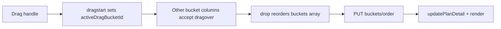

# Bucket drag-and-drop with persistence

## Goal

When board grouping is **Bucket**, each bucket column gets a drag handle. Dragging a bucket reorders that column (tasks stay inside and move with it). Order persists across reload. Progress grouping stays unchanged (no bucket handles).

## Backend: reorder API

Add `PUT /api/plans/{planId}/buckets/order` with body:

```json
{ "bucketIds": ["bkt_a", "bkt_b", "bkt_c"] }
```

Returns the reordered bucket list (same shape as existing bucket responses).

**Validation**

- `bucketIds` must be a permutation of the plan’s existing bucket IDs (same set, same length, no unknowns/duplicates).
- Reject with existing `VALIDATION_ERROR` format if invalid.

**Service** ([`BucketService.java`](src/main/java/com/example/kanbanplanner/service/BucketService.java))

- `reorderBuckets(planId, List<String> bucketIds)` rebuilds `Plan.buckets` in the requested order, keeps `tasks` unchanged, `savePlan`.

**Wire-up**

- Request DTO e.g. `BucketReorderRequest(List<String> bucketIds)`
- Endpoint on [`BucketController.java`](src/main/java/com/example/kanbanplanner/controller/BucketController.java)
- Client: `planApi.reorderBuckets(planId, bucketIds)` in [`api.js`](src/main/resources/static/js/api.js)

**Tests**

- Service: success reorder; reject missing/extra/duplicate IDs.
- Controller MockMvc: success updates order visible on `GET /api/plans/{id}`; bad body → 400.

## Frontend: handle + column DnD

In [`board.js`](src/main/resources/static/js/views/board.js):



- Only when `state.boardGrouping === "bucket"`, render a handle (e.g. `⋮⋮`) in the column header; **only the handle is `draggable`** (not the whole column), so task-card DnD stays intact.
- Track `activeDragBucketId` separately from `activeDragTaskId`; task drop zones ignore events while a bucket drag is active, and bucket drop logic ignores task drags.
- On handle `dragstart`: mark the column `.dragging`; drag image is the whole column so tasks visually move with it.
- On `dragover`/`drop` against peer bucket columns: compute new index, reorder `planDetail.buckets` optimistically, call `reorderBuckets`, rollback on error.
- No-op if dropped on same position.
- Disable while `state.isPatchingTask` (reuse existing busy flag or a shared patching flag).

Styles in [`app.css`](src/main/resources/static/css/app.css): handle cursor, column dragging opacity, optional drop-target highlight on columns (distinct from task drop-zone).

## Docs

- Note this behavior briefly under Board in Progress / does **not** expand Future Extensions.
- After implementation: run `mvn test`; if treated as a small post-9.5 UX addition, leave Milestone 10 untouched unless you want a Progress bullet added.

## Out of scope

- Manual task ordering inside a column (still forbidden by requirements).
- Bucket DnD when grouped by progress.
- Changing task fields during bucket reorder.
