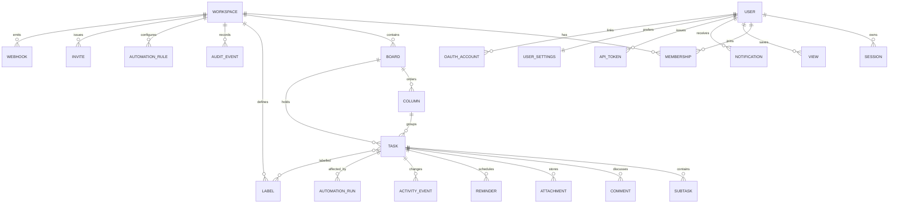

# PLAN — Project A

> Working name: **Project A**. Product UI name: **Drift**.  
> Brief version: 1.3. This plan is a living document; implementation evidence lands in `PROGRESS.md`, `REVIEW.md`, and the test outputs.

## Goal — five bullets

1. Give any person a calm, keyboard-first place to capture a task in seconds and immediately see what to do next.
2. Ship a genuinely working, locally runnable full-stack application — not a mockup — covering boards, views, search, collaboration, automation, and data ownership.
3. Make the default experience solo and frictionless, while providing real workspace isolation, RBAC, audit, retention, SSO configuration, and enterprise controls when a team/org workspace is created.
4. Meet the brief's quality bars with automated unit, integration, E2E, accessibility, security, and performance evidence, and be explicit about anything that cannot be verified.
5. Deliver design, engineering, operations, procurement, and demo artifacts together so the result can be evaluated and deployed without tribal knowledge.

## Product principles

- **Capture before configuration.** No signup wall, no onboarding modal, no empty-state essay.
- **One obvious next action.** Today proposes a capacity-shaped plan with reasons and accepts dismissal.
- **Keyboard is not a shortcut layer.** It is a complete interaction path.
- **Progressive disclosure.** Seven primary controls; everything else is in the palette, inspector, or settings.
- **Enterprise underneath, absent on the surface.** A personal workspace never shows an admin console.
- **Honest systems.** Every async action has pending, success, failure, offline, and conflict states.
- **Data belongs to the user.** Export, delete, retention, and tenant boundaries are product features.

## Chosen architecture

| Layer | Choice | Rationale |
|---|---|---|
| App | Next.js 16 App Router, React 19, TypeScript strict | Server routes and a fast client shell in one deployable unit. |
| Styling | Tailwind CSS 4 plus project design tokens/CSS | Fast custom UI without a heavyweight component runtime. |
| UI primitives | Purpose-built accessible components | Avoids hidden focus/ARIA behavior and keeps client JS small. |
| Data | Prisma 7 + SQLite (better-sqlite3 adapter) | Zero-setup local demo while retaining migrations, typed access, and a PostgreSQL path. |
| Auth | First-party opaque sessions, scrypt passwords, TOTP, OIDC | Full control over guest→account claim and tenant-aware authorization. |
| Validation | Zod at every API boundary | Shared, typed error contract. |
| Drag/drop | Pointer + native drag events, keyboard parity | No drag library in the initial JS budget; every move path shares one API. |
| Icons | Lucide React, tree-shaken | Consistent accessible iconography. |
| Tests | Vitest, Playwright, axe-core | Unit logic, browser journeys, WCAG smoke. |
| Ops | Docker, CI, health/readiness, structured logs | A deployment path that can be reviewed before production. |

## Data model (summary ERD)



Full entity definitions live in `prisma/schema.prisma`. Key invariants are enforced in both application transactions and DB relations: one board + column per task; fractional ordering; soft deletes; versioned writes; workspace-scoped authorization; audit rows for every mutation.

## API shape

- `/api/auth/*` — guest bootstrap, signup claim, password/magic link/OAuth/OIDC, MFA, sessions.
- `/api/bootstrap` — one payload for session, workspaces, boards, labels, settings, inbox.
- `/api/boards`, `/api/columns`, `/api/tasks` — tenant-scoped CRUD, moves, bulk actions, undo.
- `/api/tasks/[id]/*` — detail, checklist, comments, attachments, activity, reminders.
- `/api/search`, `/api/calendar`, `/api/today`, `/api/export`, `/api/import` — read models and data ownership.
- `/api/workspaces/*`, `/api/audit`, `/api/automations`, `/api/tokens`, `/api/webhooks`, `/api/share` — advanced and enterprise surfaces.
- `/api/health`, `/api/metrics`, `/api/openapi` — operations.
- Error envelope everywhere: `{ code, message, details?, requestId }`.

OpenAPI is delivered at `docs/openapi.yaml` and served from `/api/openapi`.

## File tree (target)

```text
app/
  api/...                 route handlers grouped by domain
  auth/                   sign-in and account-claim UI
  share/[token]/          public read-only board
  settings/               account + workspace settings
  page.tsx                app shell and all personal views
  layout.tsx, globals.css
components/
  app-root.tsx            navigation, command palette, capture, sync state
  board-view.tsx          kanban + list + drag/drop + keyboard moves
  task-drawer.tsx         detail editor and activity
  today-view.tsx          capacity plan and suggestions
  time-views.tsx          Upcoming and month calendar
  insights-view.tsx       timeline, workload, board health
  ui.tsx                  accessible primitives, toasts, dialog
lib/
  db.ts, session.ts, auth-service.ts, authz.ts, api.ts, errors.ts, validation.ts
  fractional.ts, nlq.ts, recurrence.ts, today.ts, crypto.ts
  client.ts, offline.ts, webhooks.ts, email.ts
prisma/
  schema.prisma, migrations/, seed.ts
tests/
  unit/*.test.ts, e2e/*.spec.ts
docs/                     PRD, design, API, security, ops, procurement, VPAT
public/                   manifest, service worker, icons
```

## Implementation milestones and initial estimate

> Estimates include design, build, verification, and documentation. Actuals are recorded continuously in `PROGRESS.md`; the consolidated table is in `REVIEW.md`. No milestone is a stopping point.

| Milestone | Scope | Est. BUILD h | Est. DESIGN h | Est. VERIFY h |
|---|---|---:|---:|---:|
| M0 | Plan, architecture, ERD, API contract, estimates | 4 | 2 | 1 |
| M1 | Scaffold, tokens, DB/migrations, auth shell, guest bootstrap, seed | 10 | 4 | 3 |
| M2 | Boards/columns/tasks CRUD, list view, inspector, comments/checklist | 12 | 4 | 4 |
| M3 | Kanban DnD, keyboard parity, optimistic move, undo, bulk actions | 8 | 3 | 4 |
| M4 | Today/calendar/upcoming/archive, search, saved views, reminders, recurrence, notifications | 12 | 4 | 4 |
| M5 | Tenancy, RBAC, invites, audit, retention, SSO/OIDC, MFA, export/delete, API tokens | 12 | 3 | 5 |
| M6 | Automations, AI suggestions, integrations, offline/PWA, motion, a11y, responsive, performance | 12 | 5 | 6 |
| M7 | Full QA, E2E, screenshots, deployment/ops/procurement docs, demo, review | 8 | 2 | 8 |
| **Total** | | **78** | **27** | **35** |

Time buckets: BUILD, DESIGN, VERIFY, OPTIMIZE, OVERHEAD. OVERHEAD ceiling is 15% per phase; a spike note is required after two hours on one blocker.

## Requirement traceability

| Requirement | Primary surfaces / evidence |
|---|---|
| FR-001 auth/onboarding | Guest bootstrap, `/auth`, magic link, OAuth config, TOTP, session list, sign out everywhere |
| FR-001b tenancy | Workspace switcher, create team/org, invite, RBAC guards, isolation tests |
| FR-002 boards | CRUD, templates, duplicate, archive, sharing, permissions |
| FR-003 tasks | Inspector, labels, dates, estimate, checklist, comments, attachments, activity |
| FR-004 kanban | Pointer DnD, keyboard move, collapse, WIP, optimistic + undo |
| FR-005 views | Kanban/list/calendar/Today/Upcoming/archive, saved views |
| FR-006 search | Full-text API + filter chips + instant palette results |
| FR-007 recurrence/reminders | RRULE subset, complete→next occurrence, reminder job, email prefs |
| FR-008 import/export | CSV/JSON import, JSON/CSV export, account delete |
| FR-009 accessibility | Keyboard matrix, focus management, axe, VPAT |
| FR-010 admin/audit | Audit log, retention, roles, feature flags |
| FR-011 integrations | ICS feed, webhook settings + delivery, email outbox/digest |
| FR-012 offline/PWA | Cache bootstrap, queued moves/creates, explicit sync status, conflict modal |
| SX-1…SX-6 | See `docs/PRD.md` and E2E tests |
| NFR-001…NFR-009 | See `docs/SECURITY.md`, `docs/OPERATIONS.md`, test evidence in `REVIEW.md` |

## Internal execution order

1. M0 artifacts (this file, risks, backlog, assumptions, decisions).
2. M1 scaffold + schema + migration + seed + auth/guest.
3. M2 API surface + shell + task inspector.
4. M3 board interaction + undo.
5. M4 read models + notifications + recurrence.
6. M5 tenancy + admin + security + data ownership.
7. M6 advanced surfaces + PWA + polish.
8. M7 test sweep, docs, screenshots, review.
