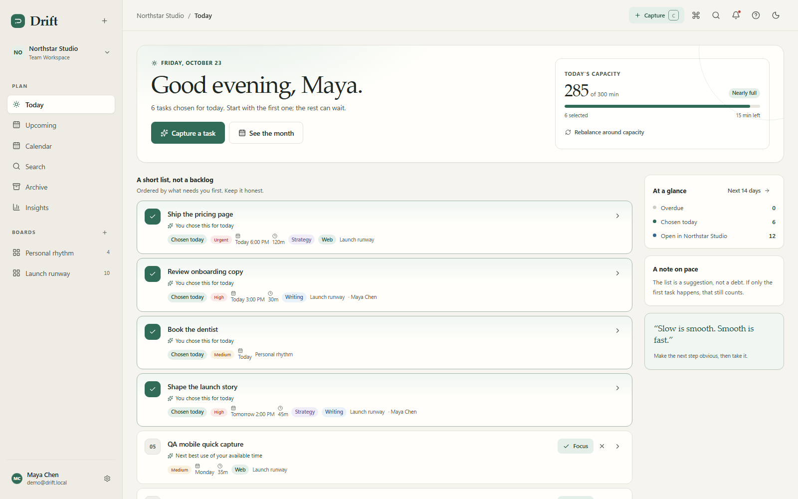
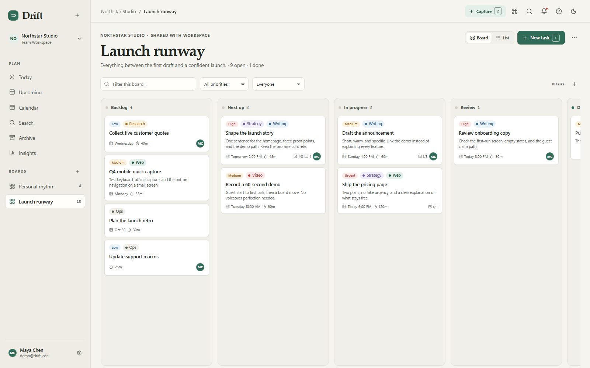
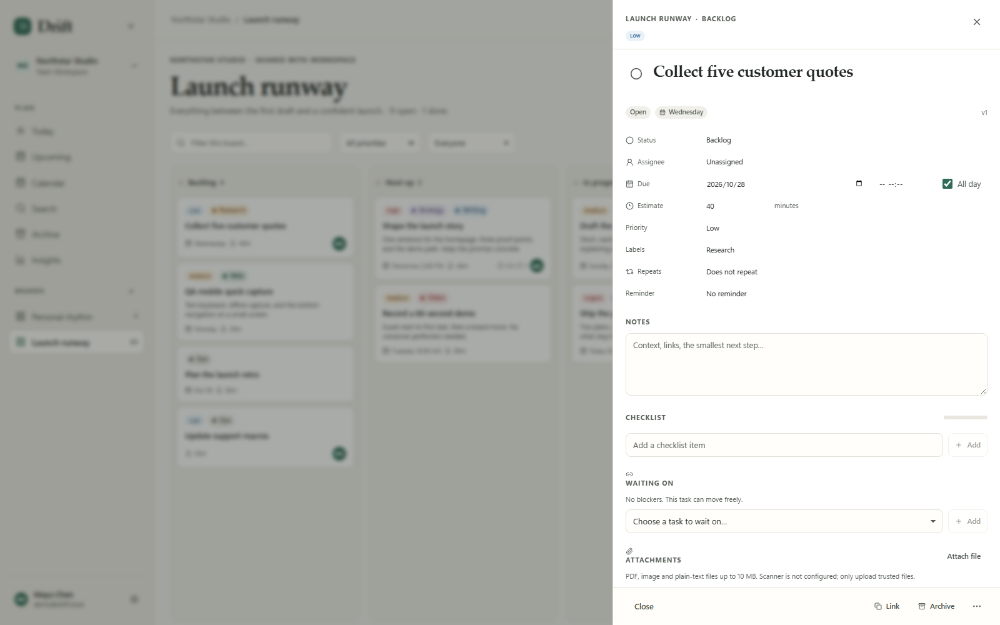
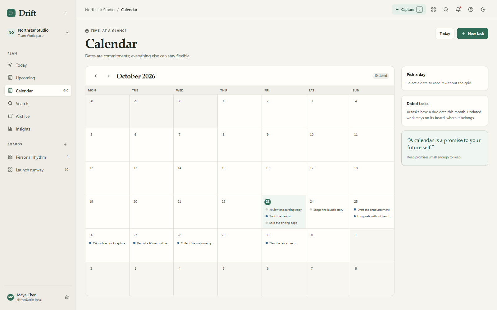
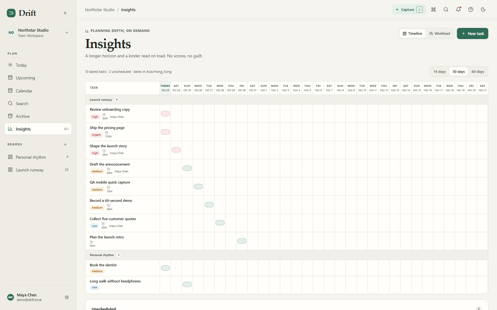
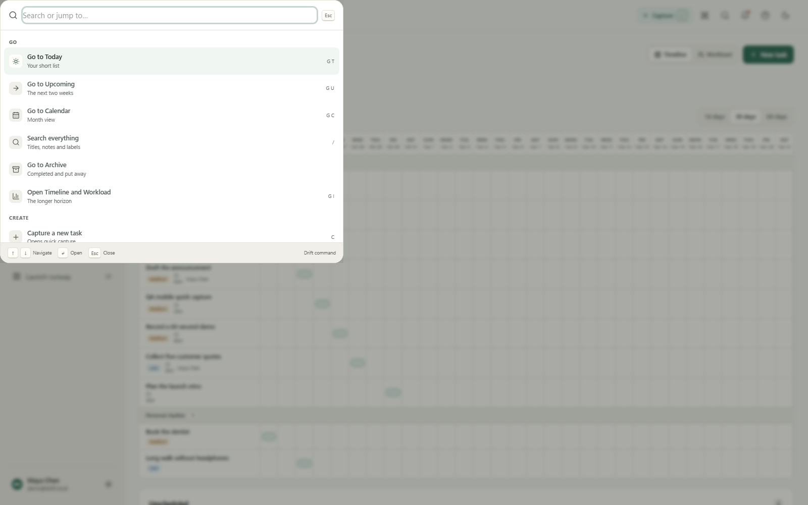

# Drift

**Drift** is a calm, keyboard-first personal task planner and Kanban board with real team and enterprise foundations. It is the working implementation of the Project A brief v1.3.

- Capture a task without creating an account.
- Plan a realistic day with capacity-aware suggestions.
- Move work by mouse or keyboard, with undo and conflict handling.
- Grow into shared boards, roles, audit, SSO, automations, and API tokens without exposing enterprise chrome to solo users.



## Quick start

Requirements: **Node.js 24+** and npm. SQLite is embedded; no Docker or external database is required for the local demo.

```bash
npm run setup -- --seed
npm run dev
```

Open <http://localhost:3000>. `setup` creates `.env` with fresh runtime secrets, applies the checked-in migrations, and seeds a demo workspace when `--seed` (or `SEED_DEMO=true`) is used.

**Demo account:** `demo@drift.local` / `DriftDemo123!`

The first visit without a session creates a real anonymous guest user, a personal workspace, and a “My tasks” board with To do / In progress / Done columns. No signup wall, modal, or tour stands between the visitor and the capture box.

### Production-style local run

```bash
npm run build
npm run start
```

### Useful commands

| Command | Purpose |
|---|---|
| `npm run dev` | Development server |
| `npm run build` | Prisma generate + optimized Next.js build |
| `npm run start` | Start the production build |
| `npm run typecheck` | Strict TypeScript check |
| `npm run lint` | ESLint (0 errors; warnings are triaged) |
| `npm test` | 78 Vitest unit tests |
| `npm run test:e2e` | Playwright journeys (12 tests) |
| `npm run test:a11y` | axe-core serious/critical scan |
| `npm run test:perf` | Authenticated Lighthouse smoke (requires a running server) |
| `npm run screenshots` | Regenerate `docs/screenshots/` |
| `npm run audit` | Production dependency audit |
| `npm run jobs` | Reminders, digests, retention, webhook retries |
| `npm run db:deploy` | Apply migrations without generating a new one |

## What is delivered

| Area | Capability |
|---|---|
| Capture | Quick capture with natural-language dates, priority, labels, estimates, recurrence; command palette; global shortcuts |
| Planning | Today capacity plan with reasons and dismissal, Upcoming, Calendar, Archive, Kanban, List, saved views |
| Tasks | Drawer editor, subtasks, comments, attachments, labels, dependencies, activity, reminders, recurrence, undo |
| Collaboration | Personal / team / org workspaces, invites, roles (owner/admin/member/guest), public read-only board links |
| Enterprise | Audit log, retention settings, SSO (OIDC), MFA (TOTP + backup codes), API tokens, webhooks, CSV/JSON import/export, account deletion |
| Automation | Rule builder, side-effect-free preview, apply, audit, 60-second undo |
| Assist | Deterministic quick-add parsing, capacity suggestions, checklist suggestions; opt-in and kill switch; no outbound customer data |
| Offline | PWA install, cached bootstrap, queued capture/move, explicit sync state, conflict 409 and review |
| Operations | Health, metrics, structured logs, request IDs, migrations, seed, background jobs, Docker/CI artifacts |

## Architecture at a glance

- **Next.js 16 App Router + React 19 + TypeScript strict** in one deployable unit.
- **Tailwind CSS 4** plus first-party accessible primitives and design tokens.
- **Prisma 7 + better-sqlite3** for a zero-setup demo; tenant-scoped queries and a documented PostgreSQL path.
- **First-party auth**: opaque hashed session cookies, scrypt passwords, TOTP MFA, magic links, OAuth, workspace OIDC SSO, guest claim.
- **Server-authoritative offline** with a version column, idempotency keys, queued mutations, and explicit 409 conflict UX.
- **Deterministic local assist** with evaluation fixtures and a global kill switch.

See [docs/ARCHITECTURE.md](docs/ARCHITECTURE.md), [docs/DATA_MODEL.md](docs/DATA_MODEL.md), and [DECISIONS.md](DECISIONS.md).

## Documentation map

| Start here | |
|---|---|
| [START_HERE.md](START_HERE.md) | Evaluator tour, evidence index, and requirement map |
| [docs/PRD.md](docs/PRD.md) | Personas, requirements, acceptance criteria, scope |
| [docs/ARCHITECTURE.md](docs/ARCHITECTURE.md) | System design, modules, data flow, tenancy |
| [docs/FLOWS.md](docs/FLOWS.md) | End-to-end flows and failure states |
| [docs/DESIGN_SYSTEM.md](docs/DESIGN_SYSTEM.md) | Tokens, type, spacing, components, responsive rules |
| [docs/MOTION.md](docs/MOTION.md) | Motion principles and reduced-motion behavior |
| [docs/ACCESSIBILITY.md](docs/ACCESSIBILITY.md) | WCAG 2.2 AA approach, keyboard matrix, gaps |
| [docs/SECURITY.md](docs/SECURITY.md) | Controls, threat model, disclosure, limitations |
| [docs/OPERATIONS.md](docs/OPERATIONS.md) | Runbook, backup/restore, monitoring, jobs |
| [docs/DEPLOYMENT.md](docs/DEPLOYMENT.md) | Local, Docker, standalone, PostgreSQL, CI |
| [docs/PERFORMANCE.md](docs/PERFORMANCE.md) | Lighthouse method and measured results |
| [docs/TESTING.md](docs/TESTING.md) | Test strategy, evidence, known gaps |
| [docs/API.md](docs/API.md) | REST contract, headers, errors, endpoint index |
| [docs/AI_GOVERNANCE.md](docs/AI_GOVERNANCE.md) | Data boundary, evaluation, oversight, kill switch |
| [docs/PROCUREMENT.md](docs/PROCUREMENT.md) | Security questionnaire and commercial posture |
| [docs/VPAT.md](docs/VPAT.md) | WCAG 2.2 A/AA conformance report |
| [docs/DEMO.md](docs/DEMO.md) | Five-minute demo script |
| [REVIEW.md](REVIEW.md) | Final delivery review, evidence, limitations, time table |

The live API contract is served at `/api/openapi` and stored in [docs/openapi.yaml](docs/openapi.yaml).

## Screenshots

| Today | Board | Task drawer |
|---|---|---|
|  |  |  |

| Calendar | Insights | Command palette |
|---|---|---|
|  |  |  |

See [docs/screenshots/README.md](docs/screenshots/README.md) for the full manifest.

## Honest limits

- Docker is not installed in the delivery environment. The Dockerfile and Compose file are provided and syntax-reviewed, but the image was **not executed** here.
- OAuth (GitHub/Google/Apple) and OIDC SSO require external provider credentials. Their routes and state/PKCE handling exist; live provider round-trips are **unverified**.
- Attachments use MIME/size checks and authenticated download, but **malware scanning is not implemented**. Disable attachments for untrusted uploads.
- Email uses SMTP when configured; otherwise a persisted development outbox is used. Invite/magic-link delivery in production requires SMTP.
- Automated axe and keyboard testing pass; **manual NVDA/VoiceOver testing was not possible** in this environment.
- SQLite is appropriate for the demo and small teams, not the 10k-user target. See the PostgreSQL rollout in [docs/DEPLOYMENT.md](docs/DEPLOYMENT.md).
- “AI” in v1 is deterministic, explainable assistance, not an external LLM. See [docs/AI_GOVERNANCE.md](docs/AI_GOVERNANCE.md).

## License / status

Private delivery artifact for the Project A brief. No license is granted for redistribution. Product name, data, and screenshots are fictional demo content.
