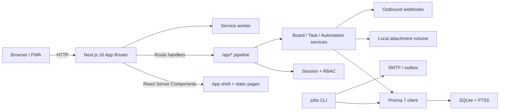

# Architecture

**System:** Drift v1.0.0  
**Style:** modular Next.js monolith with server-authoritative APIs  
**Last updated:** 2026-10-23

## 1. Context

Drift must be runnable from a clean checkout, fast for a solo user, strict about tenant boundaries, and honest about offline behavior. The architecture therefore favors one deployable unit, a small number of explicit services, and a database that requires no external daemon for the demo. Enterprise identity and scale-out paths are designed but not simulated.



## 2. Runtime topology

| Process | Responsibility | Scale unit |
|---|---|---|
| `next start` (or standalone server) | SSR, route handlers, static assets | Stateless; horizontal with shared DB + limiter |
| `npm run jobs` | Reminders, digest, retention, webhook retry, housekeeping | Single scheduler or leader-elected worker |
| SQLite file | Primary data + FTS5 index | Single writer; replace with PostgreSQL for scale |
| `data/uploads` | Attachment bytes | Replace with object storage |
| SMTP relay | Magic links, invites, digests | External managed service |

The web process can serve the entire product without the jobs process; jobs add delivery and hygiene. This separation is deliberate: a missing scheduler degrades reminders, not task capture.

## 3. Code map

```text
app/
  page.tsx                 single-page workspace shell
  auth/                    sign-in, guest claim, magic link, MFA challenge
  settings/                account, notifications, workspace, automation, integrations
  invite/[token]/          invitation acceptance
  share/[token]/           public read-only board
  offline/                 offline fallback document
  api/                     route handlers (63 documented paths)
components/
  app-root.tsx             shell state, shortcuts, sync, command palette wiring
  board-view.tsx           Kanban/list, drag/drop, keyboard move, board dialogs
  task-drawer.tsx          task editor, checklist, comments, activity, attachments
  today-view.tsx           capacity plan, suggestions, dismissals
  time-views.tsx           Upcoming and Calendar
  insights-view.tsx        timeline, workload, board health
  search-archive.tsx       search filters and archive
  quick-capture.tsx        natural-language capture
  command-palette.tsx      fuzzy actions and task jump
  ui.tsx                   dialog, menu, toast, fields, badges, avatars
lib/
  api.ts                   request pipeline: ID, auth, CSRF, rate limit, Zod, errors, logs
  authz.ts, rbac.ts        workspace membership and role matrix
  session.ts               opaque cookies, session lookup, guest creation
  board-service.ts         board/column/task read models and mutations
  task-service.ts          task mutation service, versions, activity, reminders
  automations.ts           rule evaluation, dry-run, apply
  today.ts                 ranking, capacity, reasons, suggestions
  nlq.ts                   deterministic quick-add parser
  recurrence.ts            RRULE subset and DST-safe next occurrence
  offline.ts               queue, replay, cached bootstrap
  crypto.ts                scrypt, AES-GCM, TOTP, hashes, tokens
  webhooks.ts, email.ts    outbound delivery and outbox
  oidc.ts, oauth.ts        standards-based identity flows
prisma/
  schema.prisma            36 models
  migrations/              four checked-in migrations
  seed.ts                  deterministic demo workspace
```

## 4. Request lifecycle

Every JSON API handler uses `handleApi`:

1. Generate a request ID and start a timer.
2. Apply a fixed-window rate limit keyed by public/IP + path.
3. Resolve the opaque session cookie to a viewer.
4. Reject unauthenticated requests unless the route is explicitly public.
5. Enforce same-origin on cookie-authenticated mutations (or allow a bearer token).
6. Parse and size-limit JSON; validate with Zod in the handler.
7. Replay a stored idempotent response when `Idempotency-Key` matches.
8. Execute the domain service inside the authorization boundary.
9. Serialize a domain-keyed success body or a uniform error envelope.
10. Emit a structured JSON log line with method, path, status, duration, user ID, request ID.

**Error contract**

```json
{
  "code": "VALIDATION_ERROR",
  "message": "Choose a board.",
  "details": { "fieldErrors": { "boardId": ["Required"] } },
  "requestId": "2f1c…"
}
```

Success bodies are domain-keyed (`{ task }`, `{ boards }`, `{ results }`), not wrapped in a generic `data` field. The full contract is in [API.md](API.md) and `openapi.yaml`.

## 5. Identity and sessions

- **Guest:** `POST/GET /api/auth/guest` creates a `User` with `isGuest=true`, a personal `Workspace`, an owner `Membership`, a starter board, and three columns. The raw session token is returned only as an httpOnly cookie; the database stores its SHA-256 hash.
- **Claim:** `POST /api/auth/signup` upgrades the current guest row with email, name, and scrypt password hash. The user ID and all content stay stable.
- **Sign-in:** password or magic link creates a new opaque session; the old guest session is not merged into an existing account (documented limitation).
- **MFA:** TOTP secret encrypted with AES-256-GCM; backup codes hashed; challenge route issues a short-lived challenge token; org policy can require MFA.
- **OAuth/OIDC:** authorization-code + PKCE/state, encrypted client secret, issuer discovery, nonce validation, linking by verified email. External round-trips are unverified without credentials.
- **Sessions:** 30-day absolute expiry, revocation on sign-out, “sign out everywhere,” session list. Cookie is `httpOnly`, `SameSite=Lax`, `Secure` in production.
- **CSRF:** SameSite plus an Origin allowlist for cookie mutations; bearer tokens bypass the Origin check but still require scopes.

## 6. Tenancy and authorization

`Workspace` is the tenant boundary. Every board, task, label, automation, webhook, audit row, and invite carries `workspaceId`. Access is resolved through `Membership`, never through a client-supplied role.

| Action | OWNER | ADMIN | MEMBER | GUEST |
|---|---|---|---|---|
| Read content | ✓ | ✓ | ✓ | ✓ |
| Write content | ✓ | ✓ | ✓ | — |
| Manage members/invites | ✓ | ✓ | — | — |
| Audit/retention/SSO | ✓ | ✓ | — | — |
| Delete/transfer workspace | ✓ | — | — | — |

Rules enforced in code:

- Object reads use `findFirst({ where: { id, workspaceId, ...membership } })`; a wrong workspace returns **404**, not 403, to avoid existence leaks.
- Role checks are server-side even when the UI hides a control.
- Audit and policy UI render only for team/org workspaces; personal audit rows still exist internally for investigations.
- The workspace switcher changes an `X-Workspace-Id`/query scope; it does not change identity.

## 7. Data model and invariants

36 Prisma models cover identity, tenancy, work, collaboration, automation, operations, and integrations. Key invariants:

1. A task belongs to exactly one board and one column; the column must belong to the board.
2. Ordering uses fractional lexicographic keys; moves compute a key between neighbors without renumbering.
3. Writes carry a `version`; stale writes return `409 VERSION_CONFLICT`.
4. Destructive actions create an `UndoAction` with an expiry and inverse payload.
5. Soft-deleted tasks remain queryable for retention/undo but disappear from read models.
6. Audit rows record actor, action, entity, request ID, and non-sensitive metadata; IPs are hashed.
7. Idempotency records are unique by actor + key + method + path and expire after 24 hours.
8. Attachments store metadata in DB and bytes on disk under a random name; downloads re-check membership.

See [DATA_MODEL.md](DATA_MODEL.md) for the entity table and retention rules.

## 8. Read models

| Read model | Shape | Notes |
|---|---|---|
| `GET /api/bootstrap` | viewer, workspaces, boards/columns, labels, settings, inbox, feature flags | One round trip for the shell; cached for offline |
| `GET /api/today` | plan items, reasons, capacity contract, suggestions | Capacity: total, selected, remaining, percent, overbooked |
| `GET /api/upcoming` | next 14 days grouped by local date | Timezone-aware |
| `GET /api/calendar` | tasks in a date range | Uses local date keys |
| `GET /api/insights` | timeline, workload by person, board health, focus | Progressive disclosure, no separate primary nav budget |
| `GET /api/search` | cursor-paginated results + facets | FTS5 prefix query, LIKE fallback |
| `GET /api/boards/[id]` | board, columns, tasks, permissions, counts | Single board view |

Read models are computed server-side and scoped to the active workspace. The client never filters for security.

## 9. Offline and conflict strategy

Chosen strategy: **server-authoritative with an operation queue**, not CRDT and not a full offline database.

- The service worker caches the app shell and the last bootstrap payload; navigation is network-first with an offline fallback.
- Capture and move operations are written to a versioned `localStorage` queue with an idempotency key.
- On reconnect, the queue replays in order. Successful writes refresh bootstrap; failures remain visible with retry/discard.
- A stale update returns `409` with the current server version. The client presents “Keep mine / Use server”; it never silently overwrites.
- The UI exposes `offline`, `syncing`, `pending`, and `failed` states; the offline page explains the boundary.

Limitations: queued field edits are limited to capture and move; comments/attachments require connectivity. Multi-tab queue coordination is best-effort. See [FLOWS.md](FLOWS.md) §6.

## 10. Assist (“AI”) boundary

The assistant is deterministic and local:

- Quick-add parsing extracts dates, times, priority, labels, estimates, and recurrence with regex/grammar rules.
- Today ranking scores urgency, due proximity, priority, effort, and capacity; each item exposes a reason.
- Checklist suggestions come from a small template library keyed by task verbs.
- No prompt, task, or user identifier leaves the process. There is no model provider SDK.
- Workspace `aiEnabled` plus global `AI_KILL_SWITCH`; suggestions are never auto-applied.
- Two 20-case evaluation fixtures run in Vitest (`tests/unit/ai-eval.test.ts`).

This satisfies the governance requirement without pretending an unverified external model exists. See [AI_GOVERNANCE.md](AI_GOVERNANCE.md).

## 11. Search

- SQLite FTS5 virtual table indexes task title and description, maintained by triggers.
- Query tokens are sanitized and prefix-matched; structured filters (workspace, board, status, priority, label, assignee) are applied in SQL.
- If FTS5 is unavailable, the repository falls back to parameterized `LIKE`.
- Cursor pagination caps pages at 100. The API returns a `nextCursor`.
- PostgreSQL rollout replaces FTS5 with `tsvector`/GIN; the service boundary stays the same.

## 12. Background jobs

`npm run jobs` is idempotent and safe to run every few minutes:

- Materialize due reminders into notifications/email outbox.
- Send due email through SMTP when configured.
- Build daily digest per user timezone, respecting quiet hours.
- Purge expired undo rows, idempotency keys, sessions, and retention-eligible content.
- Retry failed webhook deliveries with bounded backoff.
- Record a `JobRun` row for observability.

In serverless deployments, invoke the same command from an external scheduler/container. The web process never depends on an in-process cron.

## 13. Security architecture

- CSP, HSTS in production, frame denial, nosniff, referrer policy, permissions policy, COOP/CORP.
- Parameterized Prisma queries; Zod at boundaries; no raw SQL except vetted FTS statements.
- scrypt password hashing, AES-256-GCM for secrets, SHA-256 for tokens, timing-safe comparisons.
- Fixed-window rate limits per IP/path; stricter buckets for auth, magic links, uploads, and client errors.
- Attachment MIME allowlist, signature checks, size cap, randomized names, `Content-Disposition: attachment`.
- Audit with hashed IPs; no secrets or raw payloads.
- Production requires `AUTH_SECRET` and `APP_ENCRYPTION_KEY`; no runtime secret generation in production.

See [SECURITY.md](SECURITY.md) and [THREAT_MODEL.md](THREAT_MODEL.md).

## 14. Deployment shape

- `next.config.ts` sets `output: "standalone"` for a small runtime image.
- Dockerfile: multi-stage build, Prisma generate, Next build, runtime with migrations entrypoint.
- Compose: app + volume + optional PostgreSQL/SMTP placeholders.
- CI: install, generate, typecheck, lint, unit, build, E2E with a disposable SQLite DB, audit.
- Health: `/api/health` checks DB latency; `/api/metrics` exposes counters; logs are JSON lines.

Docker execution is unverified in this environment. See [DEPLOYMENT.md](DEPLOYMENT.md) for the exact commands and caveats.

## 15. Key trade-offs

| Decision | Benefit | Cost |
|---|---|---|
| Next.js monolith | One deploy, shared types, fast iteration | Coarse scaling; long-running jobs need a separate process |
| SQLite | Zero-setup demo, real SQL, migrations | Single writer; not the 10k-user target |
| First-party auth | Guest claim, MFA, SSO, full session control | More security code to own than Auth.js |
| Native drag/drop | Small JS, full keyboard path | Less polished touch physics than dnd-kit |
| Local deterministic assist | No data boundary risk, testable | Not generative; narrower “AI” |
| Server-authoritative offline | Predictable conflicts, no merge ambiguity | Not seamless co-editing |
| Local attachments | Works without object storage | Scanning/scale limitations |

These are recorded as ADRs in [DECISIONS.md](../DECISIONS.md).
