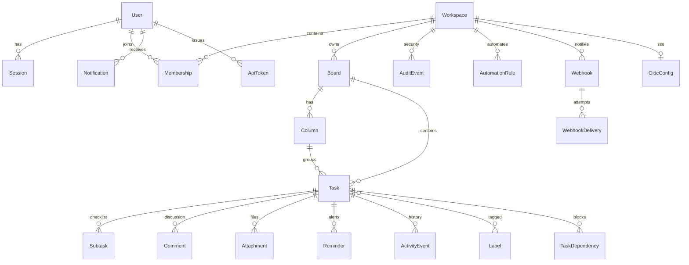

# Data model

**Database:** SQLite (demo / small team) via Prisma 7 and `better-sqlite3`  
**Schema:** `prisma/schema.prisma` — 36 models  
**Migrations:** four checked-in migrations in `prisma/migrations/`  
**Last updated:** 2026-10-23

## 1. Modeling principles

1. **Workspace is the tenant boundary.** Content rows carry `workspaceId` directly or inherit it through a board/task. Authorization always resolves through `Membership`.
2. **Soft delete before hard delete.** Tasks, boards, columns, comments, and attachments use `deletedAt`; retention jobs convert old archive rows into soft-deleted rows, and a later purge can be added without changing read models.
3. **Every mutation has an audit/activity trail.** `ActivityEvent` is the task-level feed; `AuditEvent` is the admin/security log. Both carry the request ID.
4. **Optimistic concurrency.** Boards and tasks carry `version`; task moves and edits compare the client version and return `409 VERSION_CONFLICT` rather than overwriting.
5. **Ordering is fractional.** `Column.position` and `Task.position` are lexicographic strings generated with `fractional-indexing`, so inserting between neighbors does not renumber the list.
6. **Idempotency is persisted.** `IdempotencyKey` stores the actor, method, path, status, and response body for 24 hours.
7. **Secrets are never stored in plaintext.** Session tokens, magic links, invites, API tokens, and backup codes are SHA-256 hashed; TOTP secrets, OIDC client secrets, and webhook secrets use AES-256-GCM.

## 2. Entity map

## 3. Identity and access

| Model | Purpose | Key fields / constraints |
|---|---|---|
| `User` | Person or anonymous guest | unique nullable `email`; `isGuest`; `timezone`; `deletedAt`; MFA columns |
| `Session` | Opaque login session | unique `tokenHash`; `expiresAt`; `revokedAt`; MFA timestamp; hashed IP |
| `Workspace` | Tenant | `type` personal/team/org; retention, MFA, AI, automation, attachment, sharing policy flags; `version` |
| `Membership` | User ↔ workspace role | unique `(userId, workspaceId)`; role `OWNER/ADMIN/MEMBER/GUEST` |
| `MagicLinkToken` | One-time email login | unique hash; expiry; `usedAt`; hashed IP |
| `Invite` | Pending workspace invitation | unique token hash; email; role; expiry; `acceptedAt` |
| `OidcConfig` | Workspace SSO | one per workspace; encrypted client secret; allowed domains; `enforceSso` |
| `ApiToken` | Bearer credential | unique hash; display prefix; optional expiry/revocation |
| `OAuthAccount` | Linked external identity | provider + provider account ID; unique per provider |
| `UserSettings` | Preferences | theme, density, capacity, digest hour, quiet hours, notification JSON |

## 4. Work and collaboration

| Model | Purpose | Notes |
|---|---|---|
| `Board` | Container for columns and tasks | `visibility` workspace/private; `shareToken`; `shareEnabled`; archive/soft delete; `version` |
| `Column` | Kanban stage | fractional `position`; optional WIP limit; `isDone` marks completion stage |
| `Task` | Unit of work | title, description, priority, start/due, all-day flag, estimate, recurrence, focus date, assignee, creator, `version`, archive/soft delete |
| `Subtask` | Checklist item | ordered, completed flag |
| `Label` / `TaskLabel` | Workspace label taxonomy | unique label name per workspace; join table |
| `TaskDependency` | “blocked by” edge | composite PK; both sides cascade |
| `Comment` | Task discussion | soft delete; author nullable after account deletion |
| `Attachment` | File metadata | random `storageName`; MIME, size; bytes live in `data/attachments` |
| `ActivityEvent` | Task feed | action, entity, metadata, request ID |
| `Reminder` | Per-user alert | `remindAt`, `sentAt`, channel; indexed by due time |
| `TodayDismissal` | “Not today” decisions | composite PK `(userId, taskId, date)` |
| `View` | Saved board/list view | unique `(userId, workspaceId, name)`; filters JSON; favorite flag |

## 5. Automation, notifications, integrations

| Model | Purpose | Notes |
|---|---|---|
| `AutomationRule` | Trigger/condition/action rule | trigger, conditions JSON, action type/value; board scope optional |
| `AutomationRun` | Applied automation diff | before/after JSON, request ID, `undoneAt` |
| `Notification` | In-app inbox | type, title, body, link, `readAt`; optional task/workspace |
| `Webhook` | Outbound endpoint | kind slack/teams/generic; encrypted secret; event list; last status |
| `WebhookDelivery` | Persisted attempt | payload, status, response, `attempts`, `nextAttemptAt` for bounded retry |

## 6. Operations and security

| Model | Purpose | Notes |
|---|---|---|
| `AuditEvent` | Admin/security audit | actor, action, entity, metadata, request ID, hashed IP; retention-controlled |
| `IdempotencyKey` | Replay-safe writes | unique `(userId, key)`; 24-hour expiry |
| `UndoAction` | Short-lived inverse operation | actor, entity, inverse JSON, expiry |
| `EmailMessage` | Outbox / delivery record | kind, status `queued/sent/failed/preview`, error |
| `JobRun` | Background job telemetry | name, start/finish, status, JSON details |
| `ClientError` | Browser error reports | message, stack, context, 90-day retention |
| `BackupRun` | Backup metadata | status, location, size, timestamps |
| `FeatureFlag` | Per-workspace/global flag | key, enabled, optional workspace |

## 7. Invariants enforced in code

- A task’s `columnId` must belong to its `boardId`; the task service re-checks this on create and move.
- Moving to a done column sets `completedAt`; moving out clears it. Completing a recurring task creates the next occurrence.
- A workspace must retain at least one `OWNER`; ownership transfer and member removal enforce this.
- Private boards are visible only to their creator and workspace admins/owners.
- A task assignee must be a member of the task’s workspace.
- A reminder belongs to one user; the task title and board name are read at delivery time.
- `shareToken` is random and only resolves when `shareEnabled` is true.
- Deleting an account anonymizes the user row and removes credentials; authored content remains for workspace integrity.

## 8. Search

SQLite FTS5 is created by the init migration as `TaskFts(title, description)`, with insert/update/delete triggers on `Task`. Search sanitizes tokens, applies structured filters in SQL, and falls back to parameterized `LIKE` if the SQLite build lacks FTS5. Pagination uses an opaque cursor and caps at 100 rows.

## 9. Retention and deletion

| Data | Default | Mechanism |
|---|---|---|
| Archived tasks | 30 days (`Workspace.retentionDays`) | `retention` job soft-deletes after cutoff |
| Audit events | 365 days (`auditRetentionDays`, minimum 30) | `retention` job hard-deletes |
| Sessions | 30 days after expiry/revocation | `housekeeping` job |
| Magic links | 1 day after expiry | `housekeeping` job |
| Idempotency keys | 24 hours | `housekeeping` job |
| Webhook deliveries | 30 days | `housekeeping` job |
| Email records | 30 days for terminal statuses | `housekeeping` job |
| Client errors | 90 days | `housekeeping` job |

The demo does not ship an attachment-byte purge job. Before production, add object-storage lifecycle rules or a purge job tied to `Attachment.deletedAt` and task deletion. This is tracked in `BACKLOG.md`.

## 10. PostgreSQL path

SQLite is deliberate for a zero-setup demo and small teams. For production scale:

1. Change the Prisma datasource to `postgresql` and use `@prisma/adapter-pg`.
2. Recreate migrations against PostgreSQL (do not reuse SQLite SQL).
3. Replace `TaskFts` with `tsvector` + GIN, or an external search service.
4. Move attachment bytes to S3-compatible object storage with signed URLs.
5. Run the web process horizontally and the jobs process as a singleton/leader-elected worker.
6. Re-run the E2E and performance suites against the new topology.

See [DEPLOYMENT.md](DEPLOYMENT.md) for the rollout checklist.
