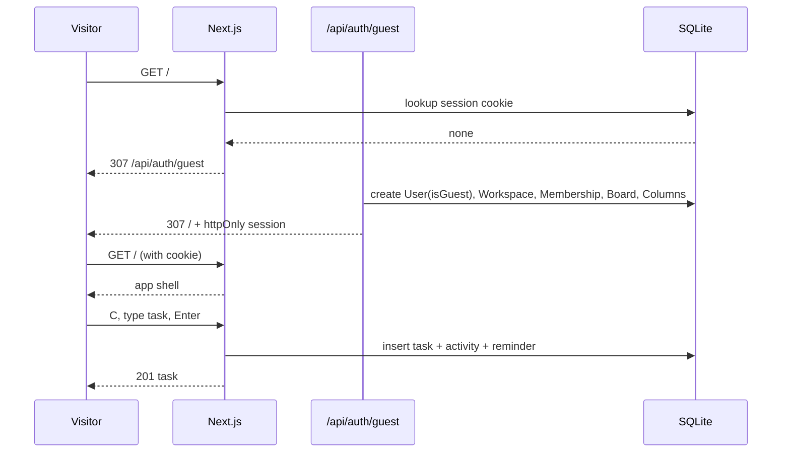
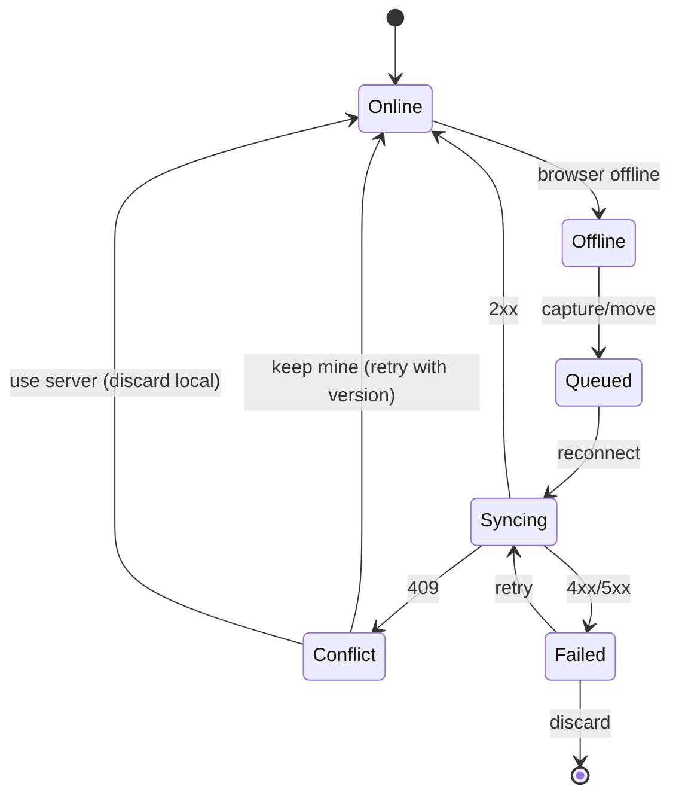

# User and System Flows

Every flow lists the happy path, the states a user can see, and failure behavior. Requirement IDs refer to [PRD.md](PRD.md).

## 1. First visit and first task (FR-001, AC-009)

**Happy path:** page loads into Today; the capture control is visible; no signup or modal. A visitor can press `C`, type, and press Enter. The task appears immediately and survives reload.

**Parsing:** `Draft launch note tomorrow 2pm !high #Work ~30m` becomes a task with a due instant, high priority, Work label, and 30-minute estimate. Recurrence phrases such as `every 2 weeks` are accepted.

**Failure states:**

| State | What the user sees |
|---|---|
| Guest creation fails | Full-page “Drift couldn’t start” with Reload / Sign in |
| Validation error | Inline field error; dialog stays open; no partial task |
| Offline | Task stored in the local queue; “Saved on this device”; sync badge |
| Server 429 | Error message with retry guidance; no silent loss |

## 2. Guest claim and later sign-in (AC-005)

1. A guest opens **Save this workspace to an account**.
2. `/auth?mode=claim` asks for name, email, password.
3. `POST /api/auth/signup` upgrades the same user row; workspace and tasks remain.
4. The response rotates the session and returns to `/`.
5. Signing out and signing back in with the password restores the same workspace.

**Failure states:** duplicate email → field error; weak password → validation; expired/absent session → sign-in page; MFA-required org → challenge.

**Limit:** signing into a *different* existing account does not merge guest content. The guest workspace remains available if the user returns to that session. This is recorded in `ASSUMPTIONS.md` A-004.

## 3. Board move, keyboard parity, undo (FR-004, AC-001/002/003)

1. Open a board from the sidebar or `G B`.
2. Pointer: drag a card to another column. Keyboard: focus a card, press `Alt+ArrowRight/Left`.
3. The card moves optimistically; a live region announces “Moved {title} to {column}.”
4. The server validates membership, board/column relationship, WIP policy, and version.
5. A toast offers **Undo** for 60 seconds for moves (10 seconds for destructive actions).
6. Reload preserves the new position.

**Failure states:**

| State | Behavior |
|---|---|
| WIP limit enforced | `409 WIP_LIMIT`; card returns; explanatory toast |
| Stale version | `409 VERSION_CONFLICT`; conflict review |
| Offline | Move queued with idempotency key; pending badge; replay later |
| Forbidden role | Control hidden; server returns 403 if forced |
| Undo expired | “That action can no longer be undone”; state remains |

## 4. Today planning (FR-005, SX-3)

1. Today loads a capacity header (`selected of total min`) and ranked tasks.
2. Each item shows a reason: due today, overdue, high priority, quick win, or carried over.
3. Suggestions propose a realistic focus set; **Dismiss** hides a suggestion and persists the dismissal.
4. Completing a task removes it from the plan and may schedule the next recurrence.
5. Changing capacity in Settings changes the contract immediately.

**Failure states:** empty plan → calm empty state with capture; overbooked → explicit warning, not a red alarm; API error → inline retry, cached plan if offline.

## 5. Search and command palette (FR-006)

1. `/` opens Search; `Ctrl/Cmd+K` opens the palette.
2. Typing queries the scoped FTS index after a short debounce; results show board/status context.
3. Filters narrow by priority, status, label, and assignee.
4. `ArrowUp/Down` + Enter opens a result; Escape closes and restores focus.

**Failure states:** no results → “No matching tasks” with query echoed; API failure → inline error; offline → cached bootstrap results only, with a notice.

## 6. Offline capture and conflict (FR-012, AC-007/AC-011)

- The queue is versioned and stored per browser; each write carries an idempotency key.
- The UI shows “You are offline”, “N waiting to sync”, a sync action, and a queue sheet.
- On `409`, the user chooses **Keep mine** (rebase on server version) or **Use server** (discard local). No silent last-write-wins.
- Failed writes remain until retried or discarded; the app never claims success it did not receive.

**Limits:** attachments, comments, and settings require connectivity. The queue covers create and move, which are the high-value capture paths.

## 7. Team creation, invite, and join (FR-001b, AC-014)

1. Signed-in user opens **Settings → Workspace → Create team workspace**.
2. Owner names the workspace; server creates a team workspace and an owner membership.
3. Owner invites by email and role. The API stores only a hash of the invite token and queues email.
4. Invitee opens `/invite/[token]`, signs in/claims, and accepts.
5. Server validates token hash, expiry, email match, and existing membership; creates a MEMBER membership.
6. The invitee sees both their personal workspace and the team; content remains isolated.

**Failure states:** expired/revoked token → explanatory page; wrong account → email mismatch message; already a member → conflict; SMTP absent → invite stays in outbox and the UI states delivery is not configured (local development shows the link).

## 8. Automation draft, preview, apply, undo (FR-010, AC-008)

1. Admin opens **Settings → Automations** in a team/org workspace.
2. Draft a trigger (for example, task moved to Done) and an action (add label, notify, set due offset).
3. **Preview** calls `POST /api/automations/preview`; it returns matches and a sample diff without side effects.
4. **Apply** creates the rule and an audit event.
5. The next matching event creates an `AutomationRun`, applies the action, records activity, and exposes undo for 60 seconds.
6. Toggling/deleting the rule is audited.

**Failure states:** personal workspace → feature unavailable with explanation; disabled flag → server rejects; no matches → explicit empty preview; partial action failure → run marked failed, no silent retry storm.

## 9. Export, import, and deletion (FR-008, AC-010)

**Export:** Settings → Data → JSON or CSV. JSON includes profile, settings, owned workspace boards/tasks/comments/activity; CSV is task-shaped. Download is generated server-side and scoped to the viewer.

**Import:** Settings → Data → choose CSV/JSON, target board. The server validates headers, caps at 1,000 tasks / 5 MB, maps columns, and reports created/skipped rows. Import never crosses workspace boundaries.

**Deletion:** Settings → Account → type `DELETE` (and password if present). The server revokes sessions, removes memberships, deletes/anonymizes owned personal content, and pseudonymizes audit actors. Org-owned content is not deleted by a member’s account deletion.

**Failure states:** malformed file → row-level errors; over cap → 413/validation; export failure → no partial file; deletion without confirmation → blocked.

## 10. Public share (FR-002, AC-012)

1. A member opens **Board actions → Share read-only link**.
2. Server creates a 32-byte token, stores its hash, and returns the URL once.
3. `/share/[token]` renders board/columns/tasks with no session, no edit controls, and no sensitive IDs.
4. Revoking invalidates the token immediately.

**Failure states:** unknown/revoked token → not found; disabled feature → 404; no mutation endpoint accepts a share token.

## 11. Admin, audit, retention, SSO (FR-010)

1. Team/org admin opens **Settings → Workspace**.
2. Members table shows role, status, and last activity; role changes and removals are audited.
3. Audit view is cursor-paginated and filterable; rows show actor, action, entity, time, request ID.
4. Retention sets the trash/audit window (7–3650 days); the jobs process purges eligible rows.
5. Integrations → SSO config stores issuer/client ID/secret (secret encrypted) and `requireMfa`; org only.
6. Members authenticate through `/api/auth/sso/[workspaceId]`; the callback validates state/nonce and links by verified email.

**Failure states:** non-admin → 403 and hidden UI; personal workspace → enterprise sections absent; SSO misconfiguration → explicit error, no fallback to password unless policy allows; provider unreachable → retry guidance.

## 12. Session and security events

| Event | User-visible behavior | Server behavior |
|---|---|---|
| Sign out | Redirect to `/auth` | Revoke current session |
| Sign out everywhere | Confirmation | Revoke all sessions for user |
| MFA enable | QR + backup codes shown once | Encrypt secret, hash backup codes |
| MFA challenge | Six-digit + backup code option | Short-lived challenge token |
| Rate limited | Retry message with `Retry-After` | 429, no state change |
| CSRF failure | Generic error | 403, no state change |
| Cross-tenant ID | Not found | 404, no existence leak |
| Account delete | Typed confirmation | Revoke, anonymize, delete owned content |

## 13. Observability flows

- Every API response carries `x-request-id`; the same ID appears in logs and audit where relevant.
- Client errors POST to `/api/client-errors` with a bounded payload; no tokens or task content.
- `/api/health` returns database latency; `/api/metrics` returns counters for jobs and requests.
- A failed webhook is retried by `jobs` and visible in settings with last status.
