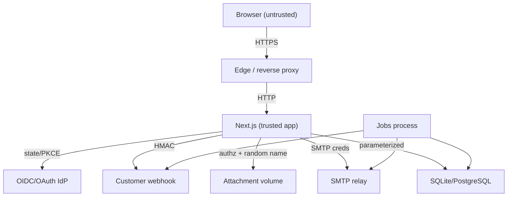

# Threat Model

**Method:** STRIDE plus abuse-case review  
**Assets:** user content, credentials/sessions, tenant boundaries, audit integrity, attachments, availability  
**Trust boundaries:** browser ↔ Next.js, Next.js ↔ SQLite/filesystem, Next.js ↔ SMTP/webhooks/IdP, admin ↔ member

## 1. Actors

| Actor | Capability | Motivation |
|---|---|---|
| Anonymous visitor | Guest bootstrap, capture | Try the product; may be malicious |
| Authenticated member | Read/write workspace content | Normal use; may attempt privilege escalation |
| Workspace admin | Membership, audit, policy | Normal administration; may overreach |
| External attacker | Network/API access | Data theft, spam, denial of service |
| Malicious file uploader | Attachment upload | Malware distribution, stored XSS |
| Compromised dependency | Build/runtime supply chain | Code execution/data theft |
| Insider/operator | DB/volume access | Data exfiltration or tampering |

## 2. STRIDE analysis

| Category | Threat | Scenario | Existing controls | Residual risk / next step |
|---|---|---|---|---|
| **Spoofing** | Session theft | XSS or network capture steals cookie | httpOnly, Secure in prod, SameSite=Lax, CSP, short-lived challenge tokens | CSP `unsafe-inline` weakens XSS defense; add nonces |
| Spoofing | Credential stuffing | Attackers try leaked passwords | scrypt, rate limits, generic errors, MFA available | No breached-password check; add at scale |
| Spoofing | OAuth/SSO forgery | Forged callback/state | State + PKCE + nonce + signature validation | Live IdP round-trip unverified |
| Spoofing | Invite token guessing | Guess another invite | 32-byte token, hash at rest, expiry, email binding | Email delivery depends on SMTP |
| **Tampering** | Cross-tenant write | Change `workspaceId`/task ID in request | Server-side membership + object scoping; 404 on mismatch | Covered by E2E isolation test |
| Tampering | Stale overwrite | Two tabs edit same task | `version` check → 409; explicit conflict choice | Queue covers create/move only |
| Tampering | Role escalation | POST role=OWNER | Role matrix + owner-only transfer | Add integration tests for every role/action pair |
| Tampering | Audit deletion | Member deletes audit row | No delete route; admin-only read; append-only path | DB operator can tamper; add hash chain/WORM |
| Tampering | Webhook spoofing | Receiver trusts unsigned payload | Optional HMAC signature header; delivery ID | Receiver must verify; document secret rotation |
| **Repudiation** | Deny action | User claims they did not move/delete | Activity + audit with request ID, actor, time | No legal-grade non-repudiation; hash chain backlog |
| Repudiation | Shared account | Multiple people use one login | Session list, MFA, audit actor | Cannot distinguish humans behind one account |
| **Information disclosure** | IDOR | Guess board/task/attachment ID | Membership-scoped queries; 404; random attachment names | Add automated authz matrix |
| Information disclosure | Public share leak | Token forwarded | Read-only, revocable, unguessable | No password/expiry; add backlog |
| Information disclosure | Export overreach | Export another tenant | Export scoped to viewer’s accessible content | Verify org-owned content rules in legal review |
| Information disclosure | Log leakage | Tokens/task text in logs | Bounded structured logs; no bodies/tokens | Review log pipeline before production |
| Information disclosure | Attachment SVG XSS | Inline SVG executes | `Content-Disposition: attachment`, nosniff, CSP | No AV; disable for untrusted uploads |
| Information disclosure | AI data egress | Task text sent to LLM | No external calls; local deterministic logic | Future provider needs DPA/opt-in |
| **Denial of service** | Auth brute force | Repeated sign-in/magic requests | Per-IP/path rate limits; scrypt cost | In-memory limiter bypassed by multi-instance; use Redis |
| DoS | Large payload | 2 MB JSON / 10 MB file | Body/file caps; multipart checks | Disk exhaustion via many uploads; add quota/cleanup |
| DoS | Expensive search | Wildcard FTS queries | Sanitized tokens, pagination | Add query timeout at scale |
| DoS | Job starvation | Scheduler down | Jobs separate; health/metrics | Add external alert on last successful run |
| **Elevation of privilege** | Guest claims admin | Guest sends admin action | Server role check; guest is MEMBER of personal workspace only | Covered by RBAC tests |
| Elevation | SSO email mismatch | Attacker controls IdP email | Verified email + issuer/audience checks; invite email binding | Configure allowed domains per org |
| Elevation | API token scope creep | Token used outside scope | Scopes + workspace binding + expiry | Add per-endpoint scope tests |
| Elevation | Dependency compromise | Malicious package | Lockfile, minimal deps, audit | Pin images/digests; SBOM in CI |

## 3. Abuse cases

1. **Spam workspace creation:** guest bootstrap is cheap; rate-limit by IP and add CAPTCHA/abuse scoring at scale.
2. **Invite bombing:** rate-limit invites per admin/workspace; monitor outbox volume.
3. **Webhook SSRF:** destination URL validation must block private/link-local ranges before production. Current implementation should be treated as admin-trusted; add egress proxy/allowlist.
4. **Attachment as malware carrier:** no scanner; disable or scan.
5. **Enumeration via timing:** generic auth errors and constant-time comparisons; avoid user-existence oracles in invite flows.
6. **CSRF via form posts:** SameSite + Origin check; bearer requests are exempt by design.
7. **Cache poisoning:** authenticated responses are `no-store`; service worker caches bootstrap locally, not shared.
8. **Open redirect:** `next` must start with `/`; OAuth/SSO redirect URIs are fixed to `APP_URL`.

## 4. Data-flow trust boundaries

Trust assumptions:

- The reverse proxy terminates TLS and forwards a trustworthy client IP only from known proxies. If `x-forwarded-for` is client-controlled, rate limiting can be bypassed.
- The database and volume are private; operators are trusted.
- Customer webhook endpoints are controlled by the customer; SSRF validation is required.
- IdP metadata is fetched over TLS from a configured issuer.

## 5. Security test coverage

| Test | What it proves |
|---|---|
| E2E cross-workspace read → 404 | Tenant scoping on task reads |
| E2E stale write → 409 | Optimistic concurrency |
| E2E automation audit/undo | Sensitive mutation traceability |
| E2E invite email binding | Invite cannot be silently reused by another account |
| Unit RBAC matrix | Role/action decisions |
| Unit crypto/TOTP | Hash/verify/encryption primitives |
| `npm audit --omit=dev` | Known production dependency advisories |
| axe serious/critical scan | Basic accessibility, not security |

Missing tests to add before regulated production: full role/action matrix, attachment content-type spoofing, SSRF URL validation, rate-limit multi-instance behavior, session fixation/rotation, OAuth/SSO live round-trip, CSP nonce enforcement.

## 6. Risk ranking

| Rank | Risk | Score | Owner action |
|---:|---|---:|---|
| 1 | Attachment malware | 20 | Disable or integrate scanner |
| 2 | Manual AT / accessibility compliance | 20 | Schedule NVDA/VoiceOver review |
| 3 | OAuth/SSO unverified | 15 | Configure test IdP and run acceptance |
| 4 | CSP `unsafe-inline` | 15 | Nonce/hash hardening |
| 5 | In-memory rate limiting | 12 | Shared limiter |
| 6 | SQLite scale/availability | 12 | PostgreSQL rollout |
| 7 | Audit not tamper-evident | 12 | Hash chain/WORM |
| 8 | Webhook SSRF | 12 | Destination validation/egress proxy |

Scores mirror [RISKS.md](../RISKS.md); this table is the security view, not a second source of truth.
