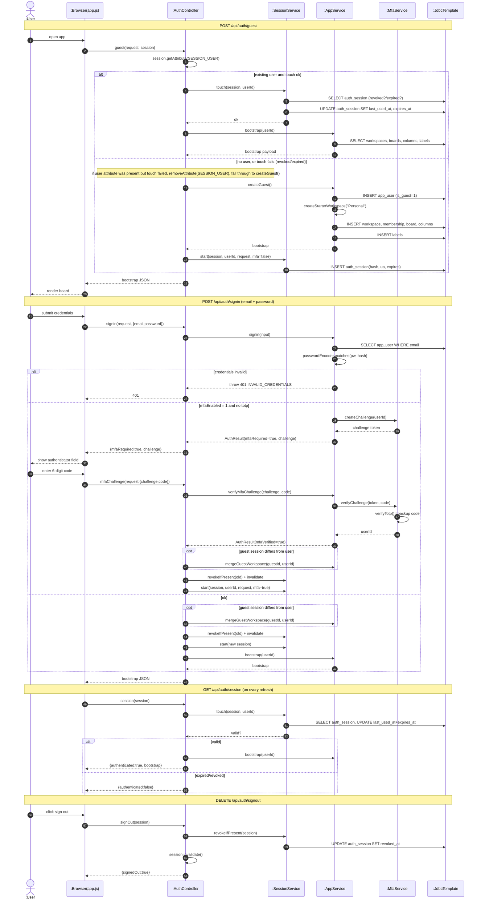

# SD01 —Authentication & Session

**Covers:** `AuthController.guest / signin / mfaChallenge / session / signOut`,
`SessionService.start / touch / revoke`, `AppService.createGuest / signin / bootstrap / mergeGuestWorkspace`.

Source: `api/AuthController.java`, `app/SessionService.java`, `app/AppService.java`.

Parsed with `app.js#request`. Control is **centralized** in the controller (fork style): the
controller decides every look-up/redirect; the service only persists.

