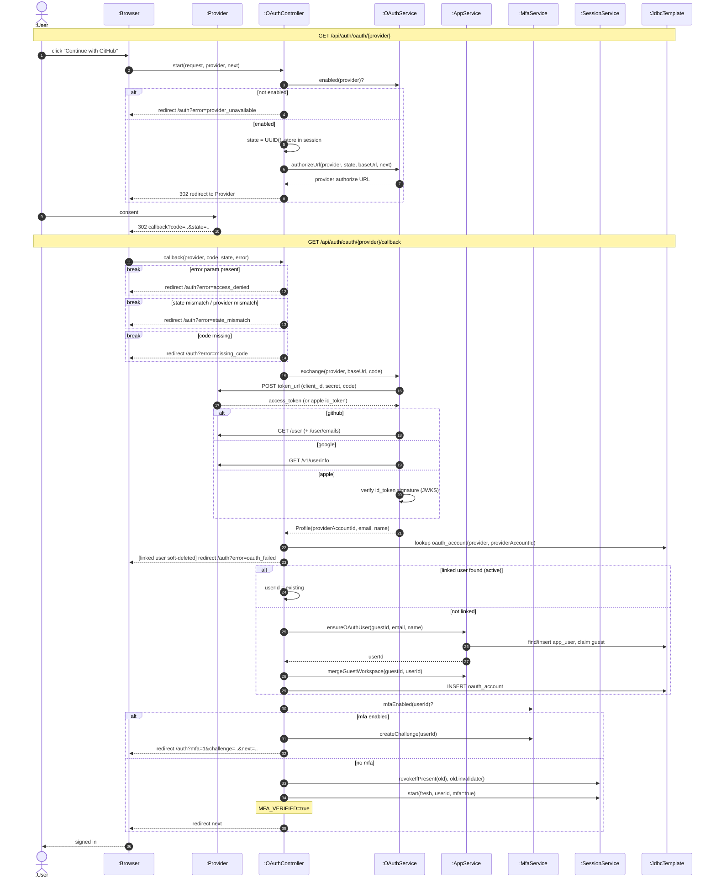

# SD02 —OAuth Sign-in (GitHub / Google / Apple)

**Covers:** `OAuthController.start / callback`, `OAuthService.exchange`,
`AppService.ensureOAuthUser / mergeGuestWorkspace`, `MfaService.createChallenge`.

Source: `api/OAuthController.java`, `app/OAuthService.java`.

External provider participates as `:Provider`. `alt/else` models the provider branches, and
`break` models a bad `state`. Control is **centralized** in the controller.

