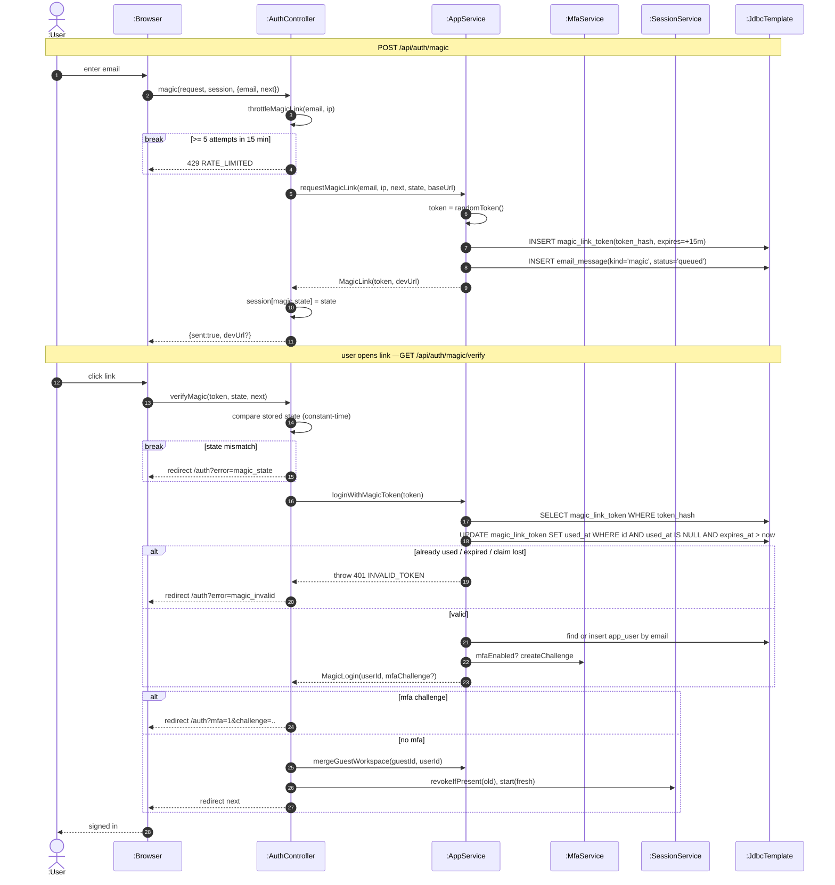

# SD03 —Passwordless Magic-link Sign-in

**Covers:** `AuthController.magic / verifyMagic / throttleMagicLink`,
`AppService.requestMagicLink / loginWithMagicToken`, `SessionService.start`.

Source: `api/AuthController.java`, `app/AppService.java`.

Throttling is a `break` (rate limit exits early). Token claim is guarded by an atomic
`UPDATE ... WHERE used_at IS NULL AND expires_at > now`; a lost claim throws `INVALID_TOKEN`.

