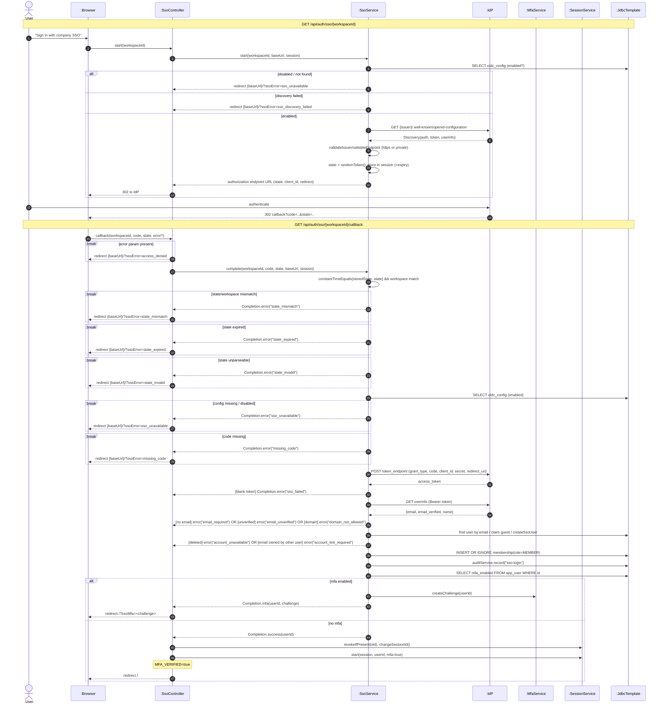

# SD04 —Organization SSO (OIDC) Sign-in

**Covers:** `SsoController.start / callback`, `SsoService.start / complete`,
`discover / exchangeCode / userInfo`, `MfaService.createChallenge`.

Source: `api/SsoController.java`, `app/SsoService.java`.

The identity provider (`:IdP`) is contacted three times: discovery document, token endpoint,
userinfo endpoint —a **stair** (delegated) sequence inside `SsoService`.

