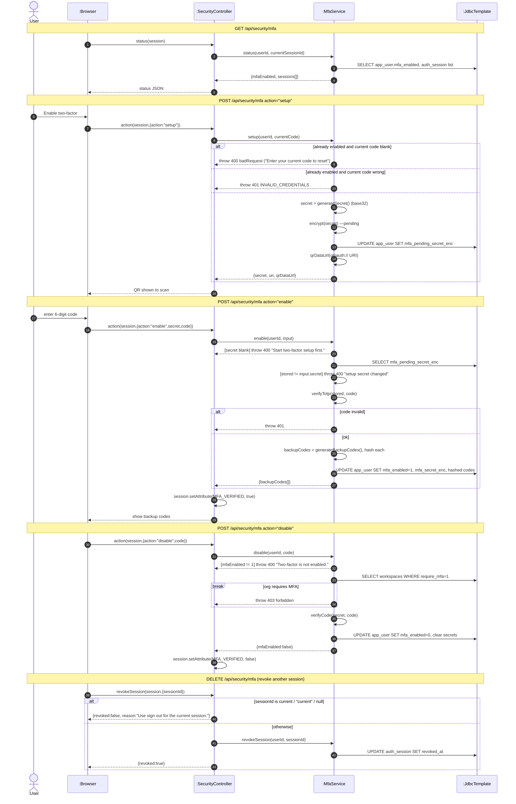

# SD05 —Two-factor (TOTP) Setup / Enable / Disable + Session Revoke

**Covers:** `SecurityController.status / action / revokeSession`,
`MfaService.status / setup / enable / disable / revokeSession / qrDataUrl`.

Source: `api/SecurityController.java`, `app/MfaService.java`.

Secret material is encrypted before it touches the DB (AES via `encrypt/decrypt`). Setup stores
a *pending* secret; `enable` promotes it. Disable is blocked if an org requires MFA (`break`).

