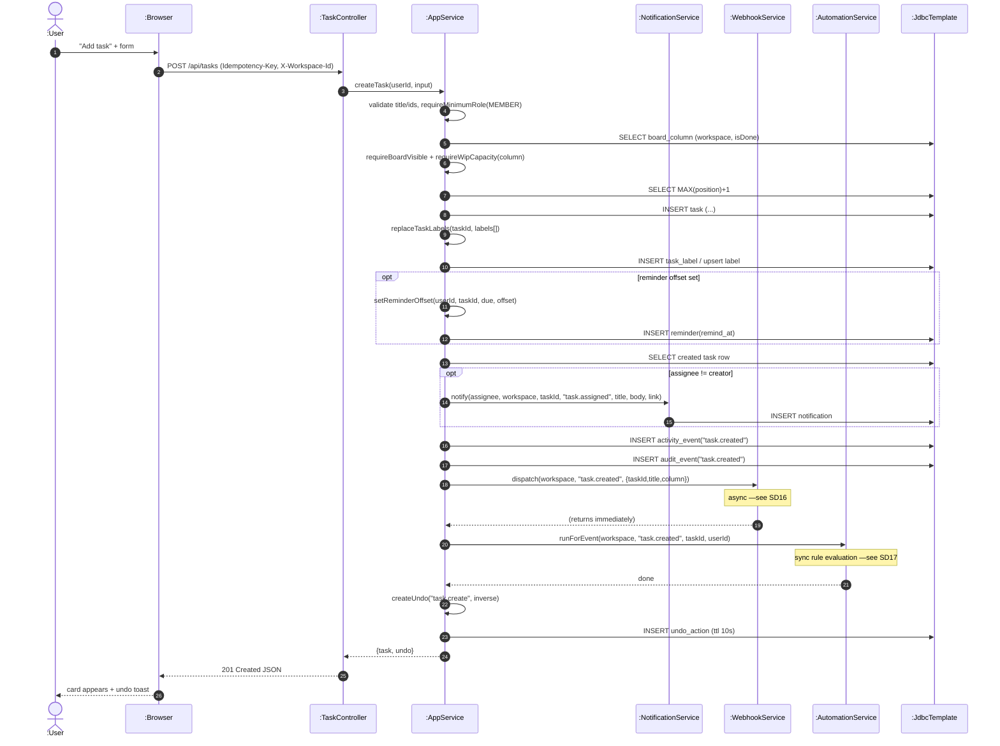

# SD06 —Create Task

**Covers:** `TaskController.create` —`AppService.createTask` —`replaceTaskLabels`, `setReminderOffset`, `notificationService.notify`,
`recordActivity`, `audit`, `webhookService.dispatch`, `automationService.runForEvent`,
`createUndo`.

Source: `api/TaskController.java`, `app/AppService.java:2288`.

This is the **centralized "fork"** style from the lecture: one method (`createTask`) drives many
independent operations whose order could change and into which new steps could be inserted
(notification / audit / webhook / automation / undo). The lecture recommends fork structure for
exactly this shape.

