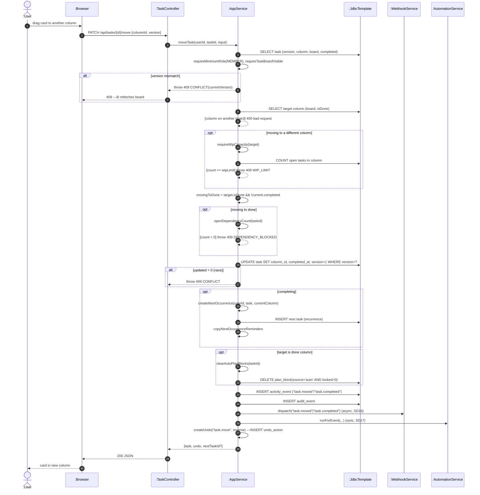

# SD07 —Move Task between Columns

**Covers:** `TaskController.move` —`AppService.moveTask` —version check, WIP capacity, dependency check, `createNextOccurrence`,
`clearAutoPlanBlocks`, activity/audit/webhook/automation/undo.

Source: `app/AppService.java:2897`.

Inside `moveTask` the checks are performed **in a fixed order** (version —column —WIP —dependency —update —recurrence —effects) —a **delegated "stair"** inside the service, which
the lecture says fits when operations must always run in the same order. Guards are shown as
`[condition]`.

