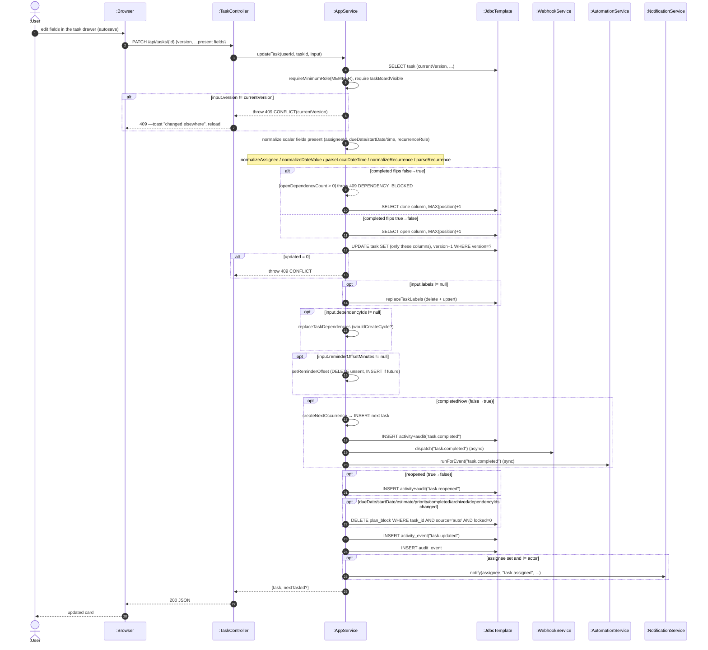

# SD08 —Update Task (PATCH with optimistic locking)

**Covers:** `TaskController.update` —`AppService.updateTask`.
Field-presence-safe PATCH: only fields present in the JSON body are changed; `version` guards
concurrent edits (optimistic concurrency).

Source: `app/AppService.java:2641`.

