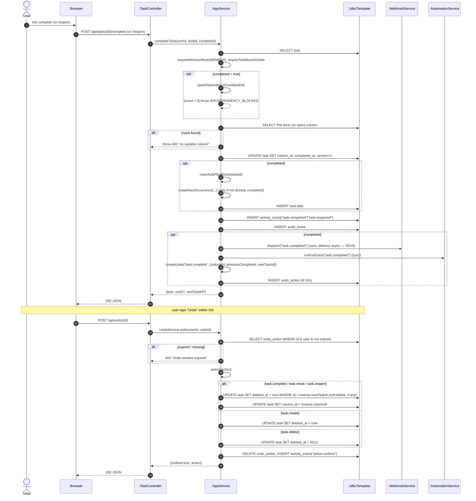

# SD09 —Complete / Reopen Task + Undo

**Covers:** `TaskController.complete / reopen` —`AppService.completeTask(userId, taskId, completed)`,
recurrence via `createNextOccurrence`, plus `UndoController.undo` —`UndoService.undo`.

Source: `app/AppService.java:3153`, `app/UndoService.java`.

`complete` and `reopen` share the same method; the boolean picks the target column. Completing
records an undo entry; reopening does not.

