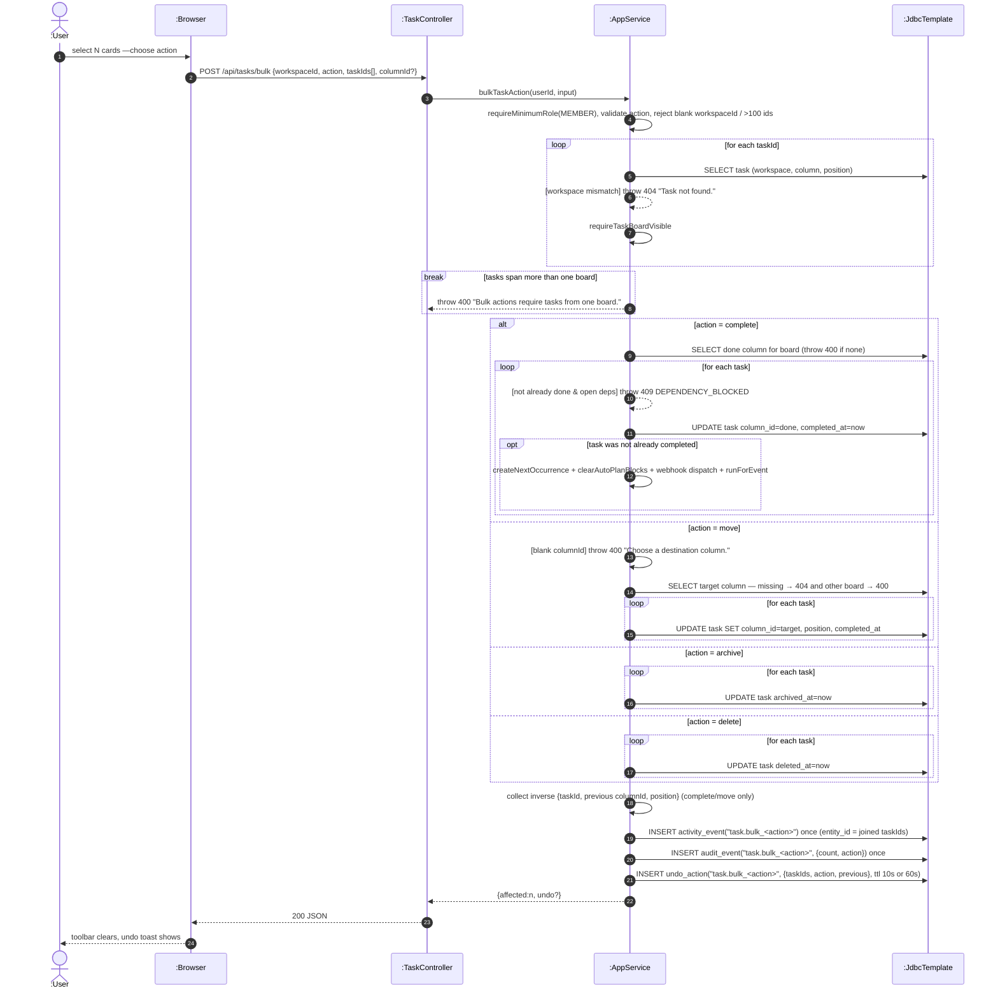

# SD10 —Bulk Task Actions

**Covers:** `TaskController.bulk` —`AppService.bulkTaskAction` (complete / archive / move / delete),
undo recorded as one entry.

Source: `app/AppService.java:2978`.

The lecture's iteration fragment (`loop`) models the per-task work; the whole operation is one
transaction and is **all-or-nothing** — a workspace mismatch, an open dependency (complete), or an
invalid target column aborts the whole call with an exception (no per-task `skip`). One
`activity_event`, one `audit_event`, and one `undo_action` are stored for all tasks.

