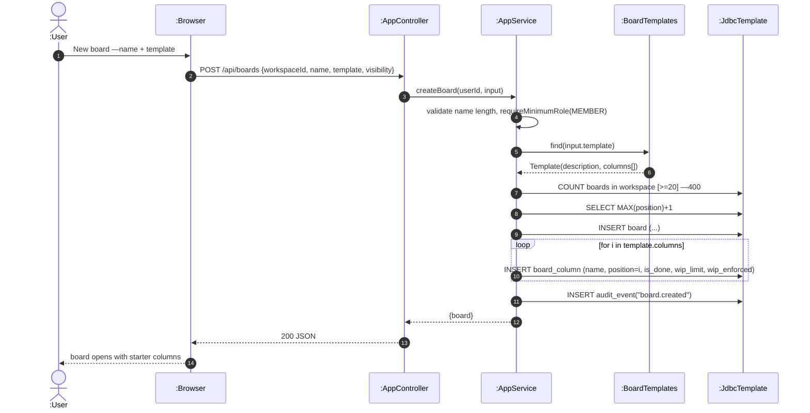

# SD11 —Create Board (from template)

**Covers:** `AppController.createBoard` —`AppService.createBoard`,
`BoardTemplates.find`, per-column insert, audit.

Source: `app/AppService.java:965`, `app/BoardTemplates.java`.

This is a **delegated "stair"**: the operations form a fixed procedural sequence
(board —columns in order —audit) that always runs the same way; the lecture says stair layout
is appropriate for that shape.

