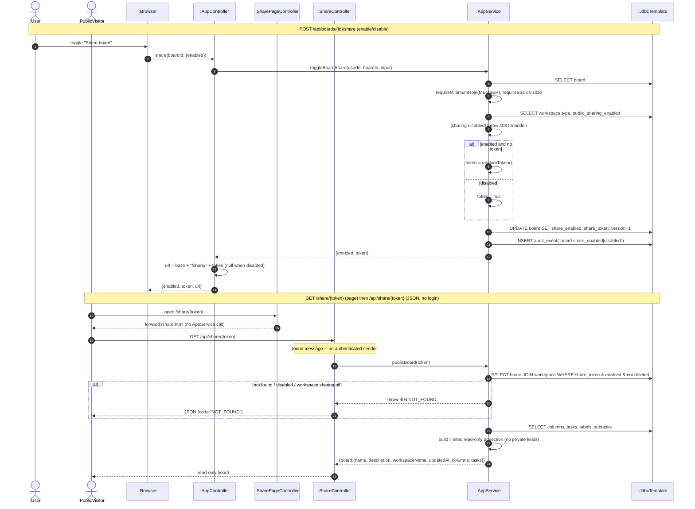

# SD12 —Public Board Share (toggle + anonymous read)

**Covers:** `AppController.shareBoard` —`AppService.toggleBoardShare`; `SharePageController` (HTML
`/share/{token}`) and `ShareController.sharedBoard` (JSON `/api/share/{token}`) —`AppService.publicBoard`
(FOUND message: no session).

Source: `app/AppService.java:1412`, `app/AppService.java:1440`, `api/ShareController.java`.

Toggle is authenticated and guarded by workspace policy; the read side has **no session**
(found message from an unknown source / a lost message back). This shows the lecture's
found/lost-message idea.

