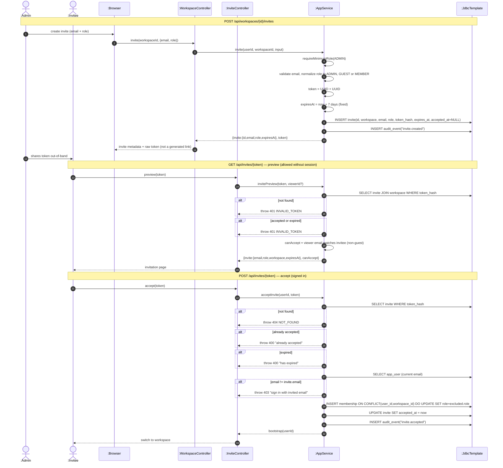

# SD13 — Workspace Invite (create + preview + accept)

**Covers:** `WorkspaceController.invite` → `AppService.invite`;
`InviteController.preview` → `AppService.invitePreview`;
`InviteController.accept` → `AppService.acceptInvite`.

Source: `api/InviteController.java`, `api/WorkspaceController.java`,
`app/AppService.java:503` (invite), `:786` (invitePreview), `:530` (acceptInvite).

Invite creation requires an email and a role; the expiry is fixed at seven days. The service
returns invite metadata and the raw token — it does **not** mint a `/invite/{token}` link.
`requireMinimumRole` is an `AppService` self-call.

