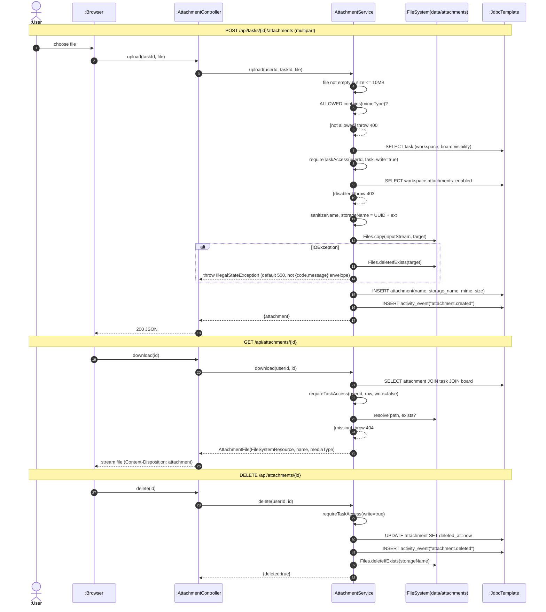

# SD14 —Attachment Upload / Download / Delete

**Covers:** `AttachmentController.upload / download / delete` —`AttachmentService.upload / download / delete`.

Source: `app/AttachmentService.java`.

File I/O is an extra participant (`:FileSystem`) that only `AttachmentService` talks to. The
service checks MIME allowlist, size (10 MB) and workspace attachment policy before writing.

