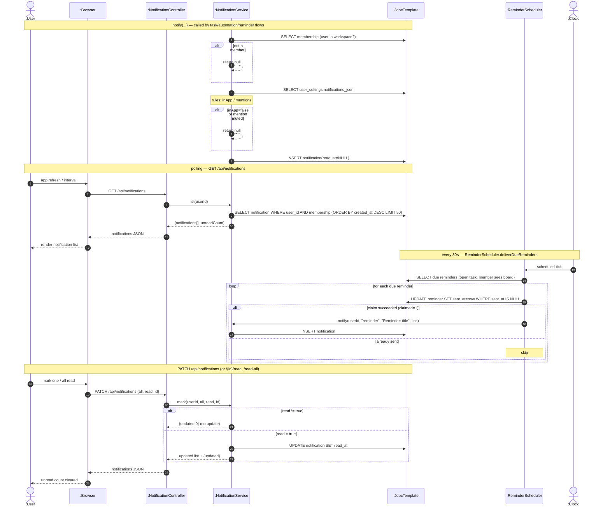

# SD15 — Notifications & Reminder Delivery

**Covers:** `NotificationController.list / mark / read / readAll`;
`NotificationService.notify / list / mark / markRead / markAllRead`;
`ReminderScheduler.deliverDueReminders` (time-triggered).

Source: `api/NotificationController.java`, `app/NotificationService.java`,
`app/ReminderScheduler.java`.

The browser **polls** `GET /api/notifications` (via `NotificationController`) to fetch notifications
— the request flows downward, it is not a push from the service. The PATCH flows (mark one / all
read) also pass through the controller. The reminder half is driven by the scheduler (a found
message from the clock).

