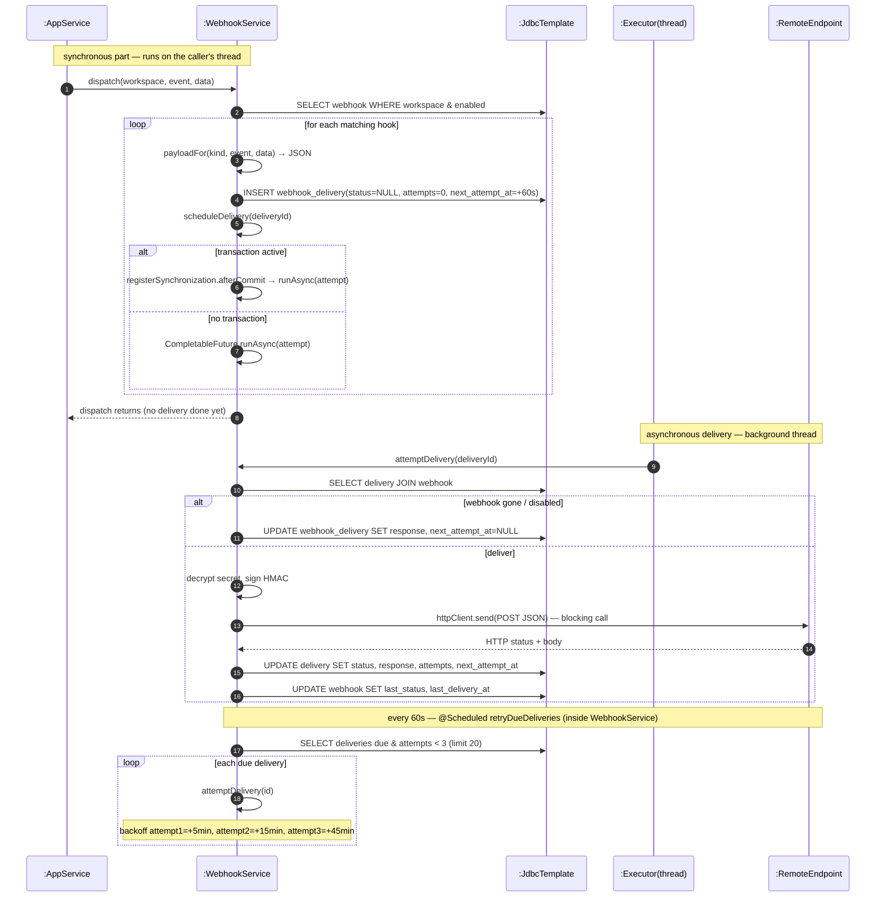

# SD16 — Webhook Dispatch (synchronous) + Asynchronous Delivery & Retry

**Covers:** `WebhookService.dispatch / scheduleDelivery / attemptDelivery / retryDueDeliveries`.

Source: `app/WebhookService.java` (`dispatch` at :149, `@Scheduled retryDueDeliveries` at :174,
`attemptDelivery` uses blocking `HttpClient.send()`).

`dispatch()` itself is **synchronous**: it runs on the caller's thread, queries matching hooks,
inserts `webhook_delivery` rows, and returns. Only the actual delivery (`attemptDelivery`) is
scheduled onto a background thread via `CompletableFuture.runAsync` (after the transaction
commits). The HTTP call is a **blocking** `httpClient.send()` even though it runs on that
background thread. There is **no separate scheduler class** — the `@Scheduled` retry method lives
inside `WebhookService`. Backoff is 5 min → 15 min → 45 min (attempts 1/2/3).

