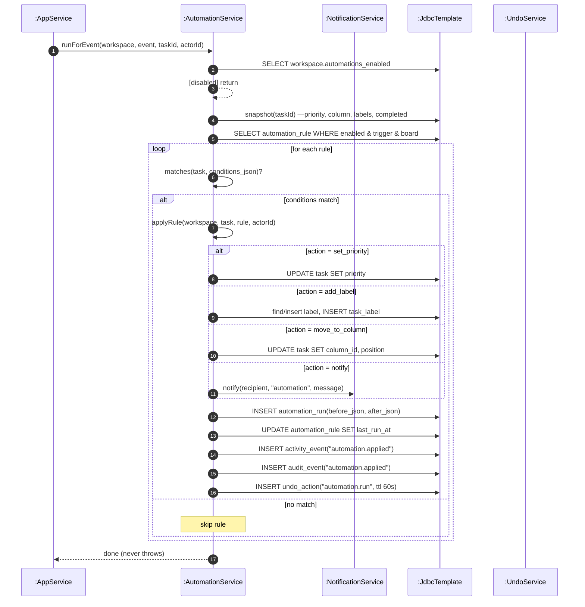

# SD17 —Automation Rule Run (on task events)

**Covers:** `AutomationService.runForEvent / matches / applyRule / preview`,
called by `AppService.createTask / updateTask / moveTask / completeTask` and `bulkTaskAction`.

Source: `app/AutomationService.java`.

Synchronous and best-effort: each rule is wrapped in try/catch so one failing rule never aborts
the task operation. Uses `loop` (rules) + `alt` (condition match) + `alt` (action type). Each
applied run writes an undo entry and audit.

