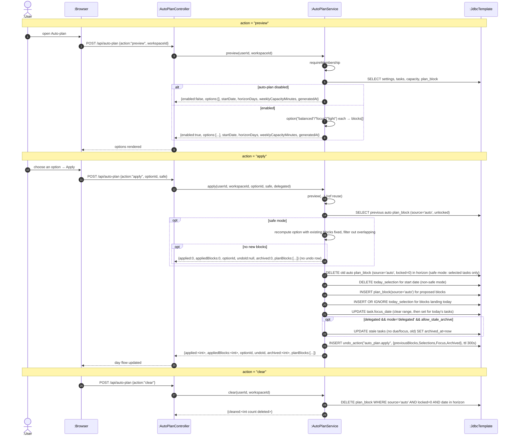

# SD18 — Auto-plan Preview / Apply / Clear

**Covers:** `AutoPlanController.run` → `AutoPlanService.preview / apply / clear / blocksForDate`,
undo via `AutoPlanService.undo`.

Source: `app/AutoPlanService.java`.

`apply` calls `preview` internally (reuse — the lecture's `ref` concept) and supports a *safe*
mode that treats existing auto blocks as fixed. Undo is handled through `UndoService`.

