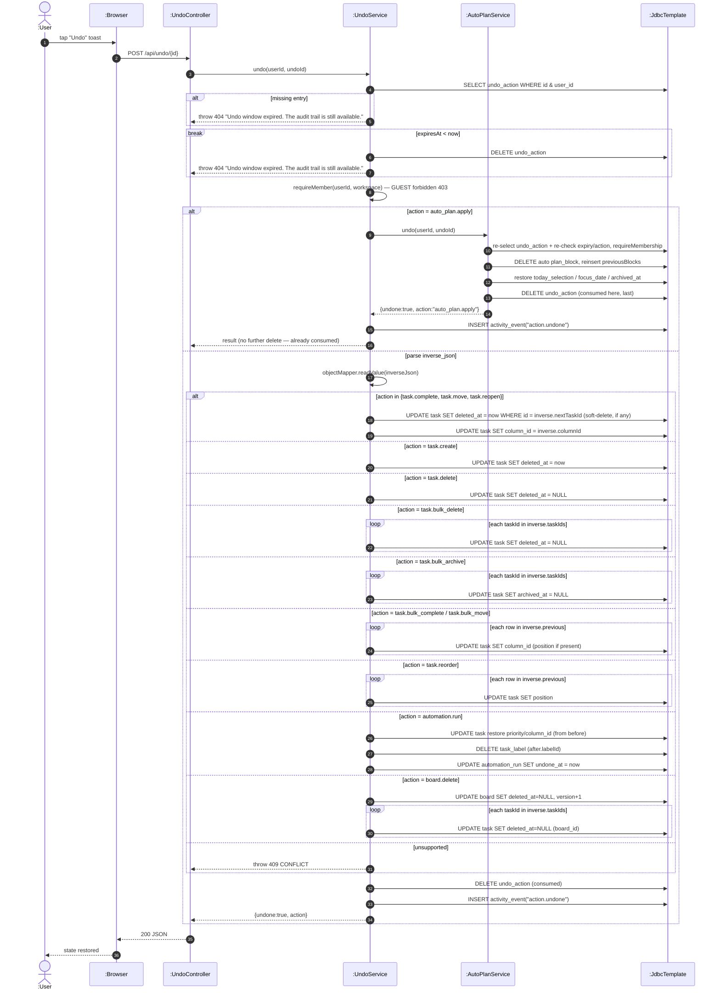

# SD19 — Undo a Recorded Action

**Covers:** `UndoController.undo` → `UndoService.undo` (dispatch by `action`),
delegating `auto_plan.apply` to `AutoPlanService.undo`.

Source: `api/UndoController.java`, `app/UndoService.java:32`, `app/AutoPlanService.java:263`.

The `alt` fragment is a switch over the recorded action type. A missing or expired entry both
return the **same** 404 `"Undo window expired…"` message (`orElseThrow` for missing, explicit
throw for expired); only the expired path additionally deletes the stale row. `requireMember` is
an `UndoService` self-call. The `auto_plan.apply`
branch is **exclusive**: `AutoPlanService.undo()` restores the plan and consumes the undo record
(deletes the `undo_action` row), then `UndoService` only writes the audit/activity event and
returns — there is no shared final delete on that path. The generic branch deletes its own record
and writes its own activity event.

