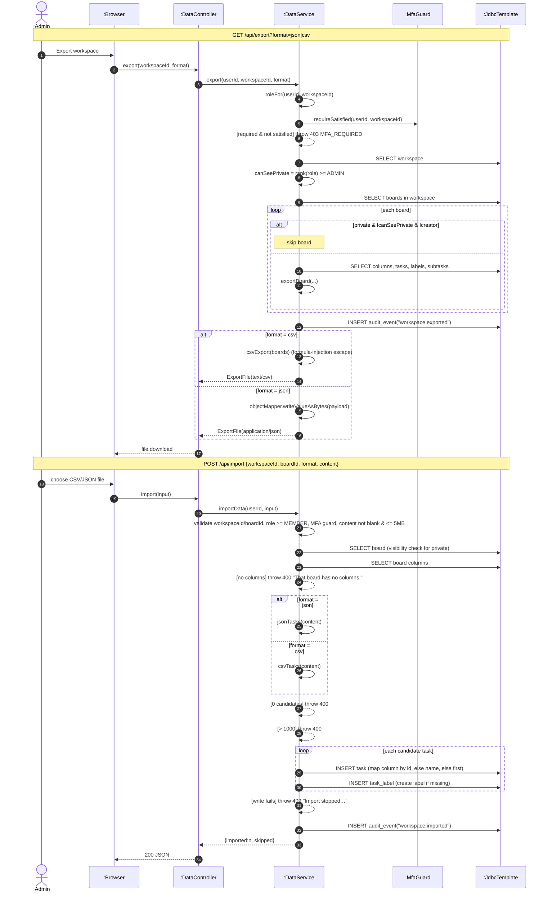

# SD20 —Workspace Export (JSON/CSV) & Task Import

**Covers:** `DataController` —`DataService.export / importData`,
`MfaGuard.requireSatisfied`, private-board filtering, CSV formula-injection protection.

Source: `app/DataService.java`.

Export is a **stair** (fixed order: role —MFA —workspace —boards —format). Import is an
`alt` on format, then a `loop` that creates tasks.

