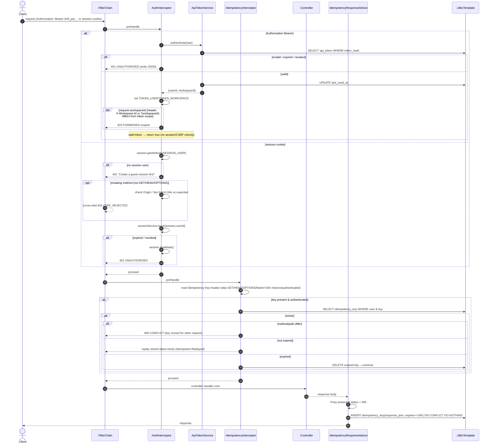

# SD21 —API-token Auth & Idempotent Replay (interceptors)

**Covers:** `AuthInterceptor.preHandle` (Bearer token / session / CSRF),
`ApiTokenService.authenticate`, `IdempotencyInterceptor.preHandle`,
`IdempotencyResponseAdvice.beforeBodyWrite`.

Source: `auth/AuthInterceptor.java`, `api/IdempotencyInterceptor.java`,
`api/IdempotencyResponseAdvice.java`.

This is the cross-cutting pipeline that every `/api/**` request passes through. Two independent
`alt`/`break` decisions: (1) is the caller authenticated & CSRF-clean? (2) is this an
idempotency-key replay?

