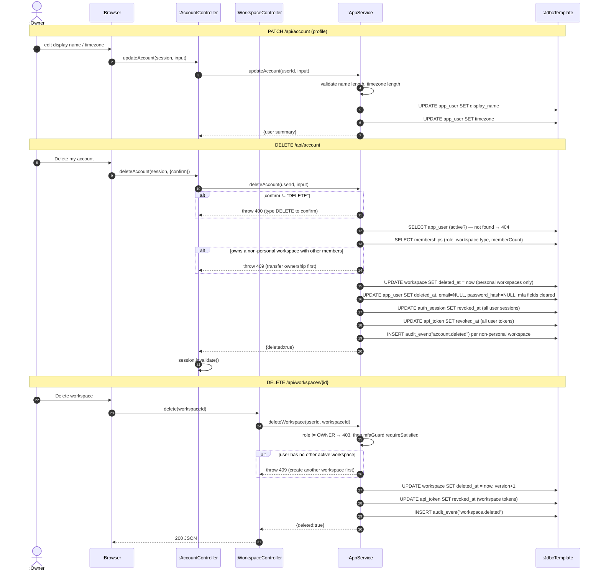

# SD22 —Delete Account / Delete Workspace

**Covers:** `AccountController` —`AppService.updateAccount / deleteAccount`;
`WorkspaceController.delete` —`AppService.deleteWorkspace(userId, workspaceId)`.

Source: `app/AppService.java:131`, `147`, `197`.

Both flows guard with ownership checks, soft-delete, clear credentials, and revoke
sessions/tokens —a delegated "stair" inside the service. Note: account/session revocation is done
with direct `UPDATE` statements inside `AppService` (no `SessionService` call), and deleting a
workspace soft-deletes only the workspace row plus its tokens (no cascade to boards/tasks).

