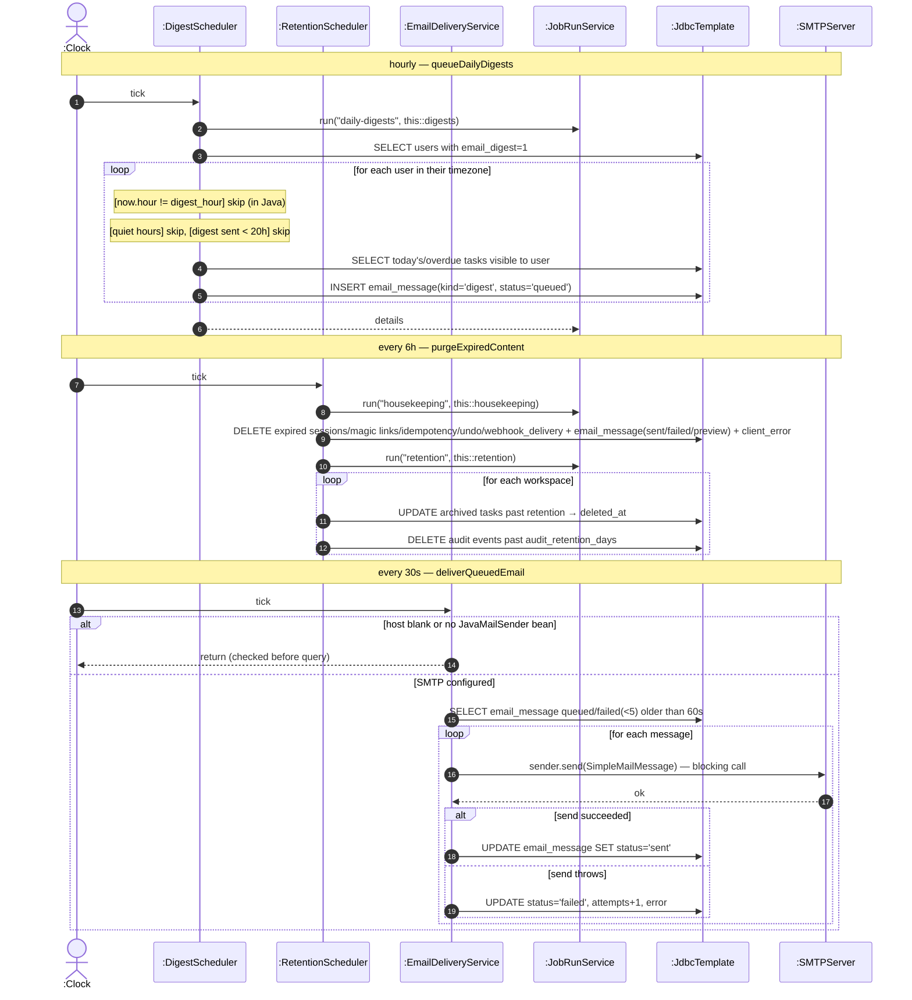

# SD23 — Scheduled Background Jobs

**Covers:** `DigestScheduler.queueDailyDigests`, `RetentionScheduler.purgeExpiredContent`
(housekeeping + retention), `EmailDeliveryService.deliverQueuedEmail`
(`ReminderScheduler` is covered in SD15). All driven by `@Scheduled` (found messages from
`:Clock`). The digest and retention jobs are wrapped with `JobRunService.run` for run history;
`EmailDeliveryService` is **not** (no `JobRunService` call).

Source: `app/DigestScheduler.java`, `app/RetentionScheduler.java`, `app/EmailDeliveryService.java`.

`JavaMailSender.send()` is a **blocking** call (not an asynchronous request). The SMTP
guard (`host` blank or no `JavaMailSender` bean) is checked **before** querying queued messages.

