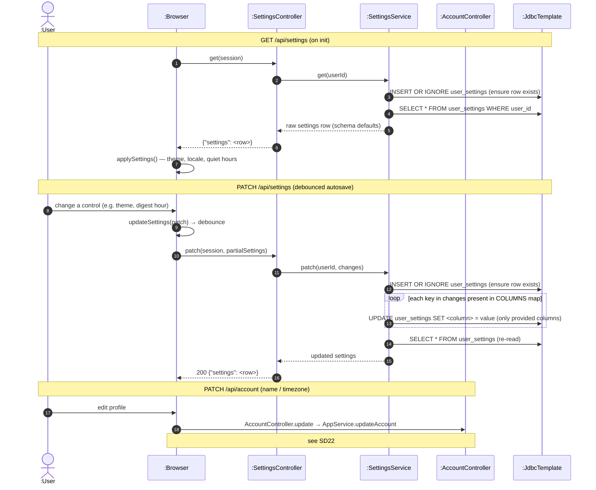

# SD24 — Personal Settings Load & Autosave

**Covers:** `SettingsController` (`GET/PATCH /api/settings`),
`SettingsService.get / patch`.

Source: `api/SettingsController.java`, `app/SettingsService.java`.

The browser loads settings on init with a dedicated `GET /api/settings` (not via bootstrap), then
`PATCH`es individual sections (appearance / language / planning / notifications / auto-plan / …)
with debounced autosave. Values are stored as raw columns (schema defaults apply); there is no
server-side parsing or bounds-checking.

